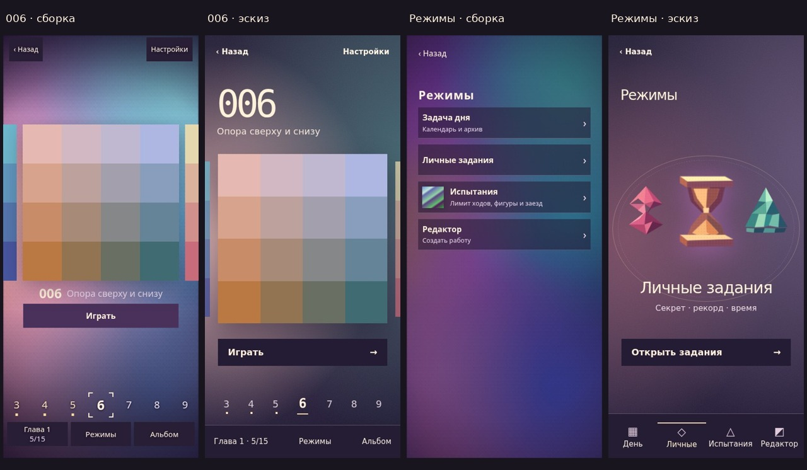

# «Полусон» · визуальный аудит 0.4.46 / 50

23 ноября 2026 · игровая ветка `feat/menu-and-board-feel`, [ebcfc5b](https://github.com/DanilaH/hue-gradients/commit/ebcfc5bf622c7e9f359db028f65a2ea3e362bac2). Проверены открытые PR №13–18 и реализация №18. Авторский масштаб уже закреплён на 100%. Номера ленты 20/26 px, счётчик главы 15 px. Увеличение текста больше не объясняет внешний вид меню.

## Что стоит переделать первым

На экране «Режимы» четыре команды собраны сверху. Большую часть кадра занимает фон. При входе в «Личные задания» внезапно появляются три объёмных, хорошо различимых предмета. Получается, что **самый интересный кадр игрок видит уже после того, как вслепую выбрал режим**. В книге с тремя собранными фрагментами происходит обратное — одного взгляда на пустое гнездо достаточно, чтобы захотеть подставить четвёртый. В проекте уже есть материал для более выразительного меню.

Слева в каждой паре настоящий экран 390×844. Справа статическая проба. У 006 взяты SVG именно этой раскладки, соседние работы и палитра с экрана. В режимах использованы три собственных предмета из игры. Попробовать в первую очередь **правую пару**. Левая нужна для выбора композиции: крупное 006 даёт характер каталожному номеру, но на 001 полосе и длинному названию может остаться мало места. Число 006 сверху — художественная проба, размер цифр навигационной ленты остаётся 20/26. Выбор шрифта, движения и отзывчивость эскизов ещё не проходили приёмку.

## Как проверено

Собрана независимая копия указанного коммита. В Chromium 141 пройдены основные маршруты через игровые кнопки, клавиатуру и эмуляцию касаний. Использованы чистый профиль, сохранённые прохождения и контролируемые даты/каталог для воспроизводимых состояний. В атласе 48 кадров, разбитых по назначению; в [указателе](frames.json) сохранены исходные размеры и сценарии. Небольшие изображения в атласе нужны для сравнения композиции. [Запись 006, 11,28 с при скорости 1×](gesture-006.mp4) показывает реальный браузерный ввод с наложенным указателем. Звуковая дорожка восстановлена из буферов игры по времени контактов. Это не микрофонная запись телефона. Точные размеры текста берём из [проверки №18](../../evidence/pr18-font-scale-0.4.46.md). На физическом телефоне в этом проходе не играли. Зрение игрока, слышимость динамика, мотор и задержку под пальцем ещё предстоит проверить. Ошибка запуска открыта по её реальной HTML-странице. Для системных окон и живых сервисов ниже указаны отдельные проверки.

**Исправление к предыдущей оценке.** Успешный возврат на 006 доказывает сохранение места. Он ничего не говорит о том, привлекает ли 006 внимание, виден ли главный жест и хочется ли открыть следующую работу. Для художественной приёмки ниже предусмотрены отдельные наблюдаемые действия.

## Из чего складывается разница с оригиналами

[20 кадров четырёх записей владельца с таймкодами](../../design/menu-and-board-feel/reference-frames.jpg) · [соответствие sourceFeatureId](../../design/menu-and-board-feel/TRACE.md) · [архив исходных APK и версии](https://github.com/DanilaH/mini-games-kit/blob/cf7cffc48b4925a897c6613949c771d3325713bb/research/games/hue/2026-11-16-apk-audit/evidence/sources.json) · [методика переноса](../../kit-guidance/REFERENCE_PROTOCOL.md).

| Игра и экран | Что можно подтвердить | Как применить |
|---|---|---|
| I Love Hue, корпус 1.3.1 (176). Титул, обучение, выбор, закрытая и начатая работа, повтор, поле, победа | В архиве титул имеет одно START. В ролике 50, 00:45–00:48, видимая работа занимает доску и перестраивается. В 01:21–01:23 номер меняется вместе с работой, соседние работы остаются видны. В финальном архивном кадре есть однозначная следующая стрелка. | На выборе оставить работающую связь превью с доской. На первом входе сразу дать тронуть цвет. Служебная шапка уступает по контрасту рисунку. |
| I Love Hue, главы, настройки, сброс, призмы | Обзор помечает текущую главу цветом. Переключение звука и отмена сброса есть в прежнем Android-проходе. Отдельно документирован выбор пакета призм. | Видимые состояния и контекст возврата пригодны. В «Полусне» энергия исключена владельцем. Покупки не входят в этот визуальный образец. |
| I Love Hue Too, корпус 2.1.1 (1013). Селектор, главы, настройки | Ролик 43, 01:35–01:52, на записи видна версия. Градиент в чёрном окружении выделяется даже на маленькой копии кадра. В главах радиальный знак занимает центр, число встроено в знак; настройки раскрываются и закрываются обратно. | Дать главе собственный узнаваемый силуэт, прогресс вписать в него. Для «Полусна» взять форму из плиток и фрагментов главы. Солнце, глаз и чёрную палитру оригинала не заимствовать. |
| I Love Hue Too, Daily Divination, сюжет, геометрические поля, помощь | Три символа прошлого, настоящего и будущего и связанные испытания описаны разработчиком. В публичном промокадре видно центральный светящийся предмет на тёмном поле. Промокадр не устанавливает штатный HUD. Помощь и цена разобраны по коду и FAQ. Живой проход всех поздних меню этой версии отсутствует. | Наши личные задания уже имеют три собственные фигуры. Вынести их на вход в режим. Календарный daily оставить отдельным маршрутом. |
| Color Puzzle, корпус 6.13.0 (142). Главная, Basic, Challenge, Creative, Leaderboard, промостраница | В ролике 29, 00:00–00:06, одно место на экране занято содержимым текущей страницы. Показ будущих обоев сообщает, ради чего открывать испытание. Порядок и состав страниц между записью владельца и архивом различаются: в архивной карусели одна страница вела к другой игре. | Перенять смену предмета и обещание награды. Состав наших четырёх входов брать из текущей игры. |
| Color Puzzle, How to Play, игра, помощь, результат | Ролик 39, 00:05, показывает сравнение до/после. В 00:27–00:31 видно собирающееся поле. В архивном просмотре решения игрок сам закрывает показ, после выхода сохраняется ход. | На 001 показать ровно один допустимый жест и его результат. Подсказку показывать на текущей задаче. На победе выдержать собранный цвет и только потом дать следующее действие. |
| Color Puzzle, свои и чужие работы, пустая коллекция, выбор цвета, имя, сохранение и тест | В архивном Android-проходе открыты пустая мастерская, новый холст, круг цвета, ввод имени, SAVE → PLAY NOW. На проверенной конфигурации клавиатура перекрывала нижние кнопки выбора цвета. | Быстрый доступ к пробе своей работы и обратимость редактирования. Проверить узкий экран с клавиатурой на реальном устройстве. |
| Color Puzzle, старт заезда, пауза, Continue/New Game, цель с лимитом, магазин и внешние сервисы | До начала заезда показана цель на 10 минут, у испытания показан лимит. В меню настроек перечислены также оценка, Remove Ads и внешние действия. Живые рейтинги, покупки, рекламные окна и системное меню публикации во всём корпусе сравнимо не воспроизведены. | Принести цель и будущую работу на выбор до старта. Для сервисов нужен реальный тестовый аккаунт/доступный оффер и запись вход → отмена → возврат. Визуальную симметрию с оригиналом пока оценить нельзя. |

Источники по дополнительным экранам: [архив кадров и UI-состояний](https://github.com/DanilaH/mini-games-kit/blob/cf7cffc48b4925a897c6613949c771d3325713bb/research/games/hue/2026-11-16-apk-audit/FEEL_UI_UX.md), [Android-эпизоды редактора, заезда, настроек, подтверждений и титула](https://github.com/DanilaH/mini-games-kit/blob/cf7cffc48b4925a897c6613949c771d3325713bb/research/games/hue/2026-11-16-apk-audit/FEEL_DEEP_PASS.md), [FAQ I Love Hue Too](https://i-love-hue.com/too/faq/), [публичные изображения Zut!](https://play.google.com/store/apps/details?id=com.zutgames.ilovehue2), [описание и примеры обоев Color Puzzle](https://play.google.com/store/apps/details?id=com.color.puzzle.i.love.hue.blendoku.game), [дополнительный разбор глав, настроек и призм I Love Hue](https://www.jafeininger.de/writing_samples/ILH_userguide.pdf). За пределами ролика 43 версию на устройстве владельца по кадрам не установили. Подтверждённые версии относятся к архивным APK.

## Экран за экраном

MATCH, PARTIAL и MISSING относятся к указанному поведению или визуальной задаче. Новые авторские решения помечены owner и не прибавляют механик оригиналам. Прямого аналога для некоторых экранов нет. Правый столбец — предложение аудита.

| Кадр / sourceFeatureId | Наблюдение в текущей сборке | Изменение и видимый результат |
|---|---|---|
| [Первый вход и полоска 001](01-campaign.jpg) · h1-swap, h1-pins | PARTIAL. Поле сразу занимает экран. На 001 четыре высокие полосы, цель спрятана в короткой подписи снизу. Между «вижу цвета» и «понимаю, что двигать» почти нет подсказки в самом объекте. | После короткого простоя один раз обозначить уголки у подвижной полосы и соседнюю цель. Убрать показ при первом касании. До принятого хода раскладка и счётчик прежние. Для reduced motion оставить статический знак. |
| [Селектор, начатые и закрытые работы](01-campaign.jpg) · h1-picker-continuity, h1-picker-to-board | MATCH для листания/возврата. PARTIAL для композиции: шапка, запуск, номерная лента и три нижних кнопки обрамляют небольшой сюжет. У закрытой работы большая пустая плоскость. | Свести превью, номер, название и запуск в одну группу. Часть соседних настоящих работ видна с краёв. Закрытая работа показывает условие и цветовой фрагмент главы, секретная сохраняет тайну. Принять на 001, 006 и длинном названии, сохранив 20/26 и все попадания пальцем. |
| [Главы, порог и финал](01-campaign.jpg) · h2-chapter-symbol | MATCH для порога и возврата; визуально три повтора «знак + пятнадцать маленьких прямоугольников + ромб» превращают главы в строки учёта. | Выбранная глава занимает центр, остальные остаются доступными. Собранные работы зажигают сегменты её авторского знака, рядом точные 5/15 и условие. Финал получает явное имя/действие. Нажать закрытую главу и вернуться на 006. |
| [Поле, захват, обмен и промах](01-campaign.jpg) · h1-swap, poluson-drop-return, poluson-contact-sound | MATCH для проверенного ввода. Поле — одна из самых убедительных сцен. Точки опор и пустое место при переносе дают информацию самим цветом. | Сохранить реальную область захвата, RGB и точку контакта. Декор увести за границы доски. При промахе виден возврат той же плитки, ход и звук подтверждения отсутствуют. Проверять в движении с одним успешным обменом и одним промахом. |
| [Победа и следующая работа](01-campaign.jpg) · poluson-win-landing, poluson-result-reveal | MATCH для проверенного порядка фаз. Самостоятельная призма и отдельный кадр результата уже есть. На неподвижном финале связи с именно этой работой меньше, чем при её сборке. | На переходе в альбом сгущать тот же градиент в новый отпечаток. Отдаление, индивидуальный хлопок плиток, локальные частицы, пауза и плавное появление команд сохраняются. Для 001 и плотной работы сравнить последний контакт и первый доступный момент кнопок. |
| [Режимы](02-meta.jpg) · cp-mode-selection | PARTIAL. Все четыре маршрута на месте. Даже при доступном контенте три строки почти одинаковы; значки и описание распределены неравномерно. | На одном месте — демонстрация выбранного режима. День показывает доступную работу календаря, личные — три предмета, испытания — фигуру или награду, редактор — полотно с четырьмя углами. Свайп только меняет превью. Именованные прямые входы открывают режим за один тап; центральная кнопка открывает выбранный. При возврате остаётся выбор. |
| [Личные задания, цель, победа/поражение](02-meta.jpg) · poluson-personal-objects | MATCH для трёх выбираемых предметов. Лучший образец внутри нашей игры. Под каждым предметом своя плашка; мелкий текст спорит с выбором в центре. | Оставить силуэты и заметные зоны касания. У одного выбранного предмета собрать название, условие, рекорд и действие. Смена выбора меняет свет предмета и фон. В финале вернуть именно его и соответствующую цель. |
| [Daily, календарь, архив, ожидание и кэш](02-meta.jpg) · poluson-daily-month | PARTIAL. Дни хорошо узнаются как календарь. Тёмная решётка и блок под ней больше похожи на выбор даты записи. Есть реальные состояния запроса и кэша. | Сохранить месяц и быстрый выбор даты. Ввести крупный цветовой отпечаток выбранного дня, выделить сегодня и собранное формой метки. Для будущего, отсутствующих данных и офлайна показывать только известное. На возврате остаются месяц, дата и фокус. |
| [Книги, гнездо, событие](02-meta.jpg) · poluson-book-sockets, poluson-dated-event-return | MATCH для перехода из гнезда в 006. Книга 3/4 уже даёт ясную цель. Обложки соседних книг отличаются в основном палитрой. | Сделать форму незаполненного гнезда и рисунок переплёта различимыми издалека. Выигранная работа занимает ровно обещанное место. Сохранить отдельный вход по дате события и восстановление источника. |
| [Прогресс и история](02-meta.jpg) · owner-progress-art | PARTIAL. Счёт, XP и история доступны; обзор повторяет список глав и полосу. | Собранные работы формируют цветовой знак главы, выбранный сегмент ведёт к работе. Числа и раскрываемая история остаются для сверки. На пустом профиле показать место первого отпечатка, на 15/15 — завершённую форму. |
| [Испытания, лимит, заезд, фигуры, финал, секрет](03-challenges.jpg) · cp-challenge, cp-timed, h2-boss | PARTIAL. На чистом профиле видны сразу несколько похожих закрытых строк. Проба обмена полезна, однако картинка испытания уступает списку. При открытии фигуры доска сама объясняет её характер. | До старта показывать одну настоящую геометрию либо честный силуэт секрета и одну цель — лимит или время. Список и быстрый доступ к номеру сохраняются. Секретное поле раскрывается только по действию. Проверить попадание в треугольник, крупную сетку и отсутствие преждевременного спойлера. |
| [Лимит исчерпан, время вышло, успех](03-challenges.jpg) · poluson-loss-retry | MATCH для отдельных исходов и повтора. На неудаче несколько строк оказываются в самом цветном месте поля; контраст зависит от работы. | Подкладывать компактную непрозрачную полосу только под результат и команды. Показать факт «6 из 6» либо время и счёт, выделить повтор; выход возвращает к исходной задаче. Не использовать торжественную призму при поражении. |
| [Альбом, вкладки, пустая коллекция](04-studio.jpg) · poluson-album-print-return, owner-album-art | PARTIAL. В наполненном альбоме цвет уже ведёт взгляд. У пустого — текст и две кнопки с большим просветом. | Одна пустая рамка даёт понятное место первой работе и ведёт к текущей кампании. В наполненном сохранить сетку и положение прокрутки. При возврате выделен тот же отпечаток. |
| [Одна работа, действия, экспорт/копия](04-studio.jpg) · cp-author-proof, poluson-single-wallpaper | MATCH для принципа одного выбранного полотна. В полноэкранном просмотре рисунок убедителен. Форма имени копии отличается от остальной игры округлой рамкой и светлыми кнопками. | Общее компактное оформление служебных листов, миниатюра исходника рядом с именем. Экспорт сохраняет плавные полноэкранные обои в размере устройства. Зерно интерфейса, скобки, точки и текст в файл не попадают. Отмена экспорта возвращает работу. |
| [Главная редактора, холст и инструменты](04-studio.jpg) · cp-editor | PARTIAL. На свежем профиле в «Редакторе» только заголовок и «Создать». На следующем экране уже существует гораздо более выразительный холст с четырьмя углами. | На входе показать пустой холст с четырьмя точками цвета. Первое действие ведёт в редактирование; черновик создаётся по существующему правилу. На повторном входе показать настоящую последнюю работу и отдельно «Создать». |
| [Размер, цвет, опоры, перемешивание, история, авторская проверка](06-states.jpg) · cp-editor, cp-author-proof | PARTIAL. Сам градиент легко узнать. История с миниатюрами выразительнее текстового списка инструментов. | В каждом инструменте оставить полотно в той же системе координат. Выбранный угол связан с палитрой меткой. Видны «Применить» и «Отмена» с открытой клавиатурой. Для истории показывать реальную версию, после теста сохранять исходный черновик и место. |
| [Пауза, два входа в настройки](05-service.jpg) · h2-settings-context | MATCH для контекста возврата. Из паузы — стопка одинаковых команд и системные квадраты; из меню — другая вертикальная панель. | У паузы главное действие «Продолжить». Настройки обоих входов используют одни роли, знаки включения и отступы. Независимые звук/музыка/вибрация/движение имеют подписи. Закрытие возвращает к той же работе или незавершённому ходу. |
| [Помощь, образец поля, памятка, перезапуск и восстановление](05-service.jpg) · poluson-help-samples, cp-preview | PARTIAL. У помощи есть маленькие примеры и цена, но по первому взгляду она читается как ещё одна пауза. Восстановление и перезапуск — разные по последствиям задачи. | Помощь показывает «до → после» на фрагменте текущей работы и стоимость до подтверждения. В просмотре решения удерживать картинку до закрытия. Для ошибки и разрушительного повтора оставить короткий текст и явно подписанные действия. |
| [Стартовый сбой, ожидание/сбой загрузки, ошибка сохранения PNG](06-states.jpg) · owner-service-recovery | PARTIAL. Сбой календаря очищает почти весь экран. В экспорте работа, наоборот, остаётся видна — это лучше сохраняет контекст. | При наличии кэша сохранять его видимым, рядом повтор и статус. При пустом кэше не рисовать вымышленный день. Ошибка WebView должна читаться без игрового рендера, шейдеров и сети. |
| Внешние окна и недоступные экраны · owner-platform-ui | UNKNOWN. Android chooser, клавиатура, реальный рекламный показ, покупка/восстановление покупки и боевой сервер не подтверждены данным прогоном. Облако на паузе. | Для приложимых интеграций записать устройство, точку входа, готовность оффера, отмену, возврат, звук, сохранение выбранной работы. Художественная оболочка нужна только вокруг собственных состояний игры. |

## Порядок работы разработчика

1. **Режимы и выбор 006.** Собрать живую пробу на текущих данных с настоящими четырьмя входами, не переписывая остальные экраны. Для каждого режима задать свой главный объект и два состояния — обычное и пустое/закрытое. Для 006 сохранить навигацию, касания и состояния прогресса. Зафиксировать 390×844 и 320×568 при 100%, включая самую длинную подпись. Эскизы выше задают гипотезу, владелец принимает композицию по фактическим кадрам.
2. **Первый жест и следующий заход.** Запись 1×, со звуком и повтор без звука. 001 → первый обмен → результат → 002. Отдельный дубль 006 — короткий свайп в селекторе, запуск, захват, промах, принятый ход, пауза, возврат. При выборе палитра меняется пропорционально движению и возвращается при отмене. Зерно мелкое и спокойное в покое, всплеск дизеринга начинается при посадке. На поле проверить пары ближайших цветов. У принятого хода один контактный звук, у неудачного нет победного подтверждения. Haptics проверить пальцем на телефоне. Не увеличивать длительность каждого перехода ради эффекта.
3. **Прогресс и причины вернуться.** Сначала книга 3/4 → 006 → 4/4, затем календарь с реальной архивной работой, затем испытания и главы. Связать превью с настоящей наградой. Режимы с секретом сохраняют скрытую информацию. Для PNG и заполненного гнезда сверить цвет и источник с исходной работой.
4. **Мастерская и служебные листы.** Пустая мастерская → угол → цвет → проверка версии → возврат → экспорт. Затем пауза, режимы помощи, настройки, подтверждения, ошибки. У каждого слоя явно подписан выход и восстанавливается фокус.

**Проверка впечатления.** Дать человеку чистую игру на телефоне. Спросить «Где здесь попробовать испытание?» и «Что ты получишь за эту работу?», затем молча дать выполнить действие. Записать первый тап, лишние возвраты и что игрок назвал наградой. На кадре режимов без текста попросить отличить редактор от заезда, затем вернуть подписи и проверить самостоятельный вход. Если различие держится только на подписи, дорабатывать предмет режима. Если человеку нравится неподвижный эскиз, но он промахивается в игре, переделать живой экран. Форму окончательного знака и гарнитуру утверждает владелец.

**Что можно генерировать.** Из исходных цветов уровня процедурно получать свет фона и обложку, из фактических пройденных работ — заполнение знака. Генерация изображений уместна для эскизов одного авторского предмета/силуэта главы, с ручным выбором и доводкой. Игровые плитки, соседние работы, подсказки, экспорт и данные календаря имеют точный источник. Звуки выбрать из собственных коротких записей или синтеза, сравнить на телефоне при тихой громкости. Не озвучивать каждый кадр прокрутки.

**Отдельная техническая находка.** Штатный `challenge-browser-check.mjs` на этой ветке ждёт «Дальше» после двух возвратов. На экране в этот момент 001 с «Продолжить». Самостоятельный повтор без съёмочного перехватчика дал тот же тайм-аут. В исследовательской копии после возврата явно открыли 001, дождались завершения входа на доску и видимого текста результата после анимации. С этими условиями прошли и победа, и проигрыш на шестом ходу. Исправить сценарий приёмки в игровой ветке. Это конкретная ошибка теста, поломка испытания не установлена.

**Основания по коду** · [роуты и композиция режимов](../../../src/game/metaView.ts) · [слои доски, вход и результат](../../../src/game/mountGame.ts) · [альбом](../../../src/game/albumView.ts) · [студия](../../../src/game/editorView.ts) · [обои](../../../src/game/workCardView.ts) · [стили](../../../src/game/game.css) · [условия старого теста](../../../tools/challenge-browser-check.mjs).

KIT IMPACT — REUSE. Для этой задачи достаточно протокола сравнения референсов и правил композиции. Изменены исследование и передача разработчику.
