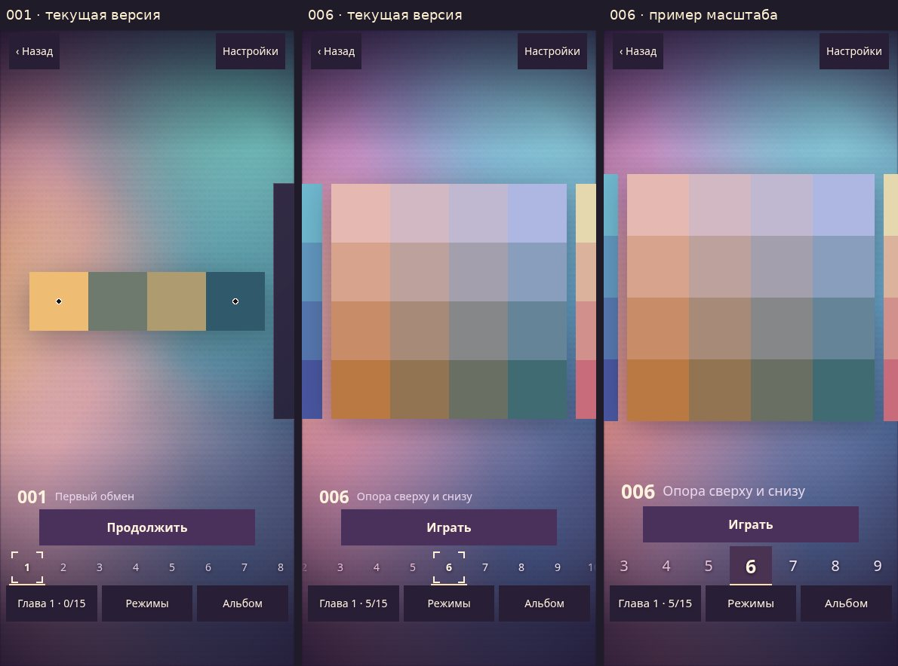
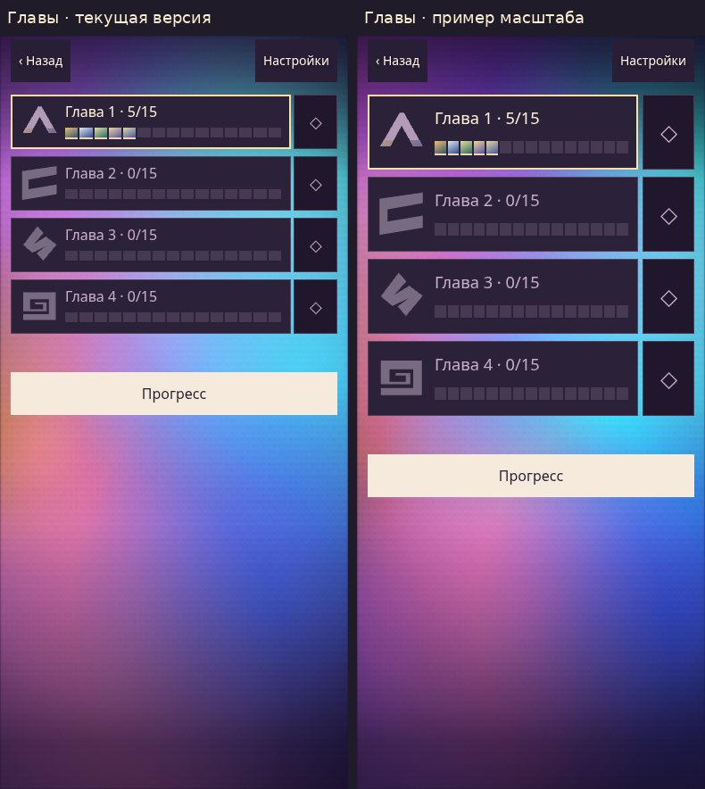

# Масштаб экрана «Уровни» · независимая проверка 0.4.44 / 48

Игровая ветка `feat/menu-and-board-feel`, коммит `3ae4ad88af1c132b38c96b3dd5eef66314f25efd`. В `feat/m0-foundation` на момент проверки ещё 0.4.43. Для замечаний использована реализация ТЗ №16. Лента уже двигается за пальцем и доводит выбранный рисунок в центр. В сборке есть возврат из настроек и отдельный вход в режимы. Текущий вопрос — удобство выбора глазами и пальцем. [ТЗ №16](https://github.com/DanilaH/hue-gradients/pull/16) · [приёмка разработчика](../../evidence/pr16-menu-board-0.4.44.md)

## Что увидел игрок

**Первый уровень.** На чистом профиле открыл «Уровни» в собранной веб-версии. На экране 390×844 сама композиция 001 занимает полосу 312×78 px. Четыре квадратные клетки и форма 4×1 верны. Но от нижней границы рисунка до строки с названием около 210 px. Справа виден тёмный край высокой заглушки соседней закрытой работы. Даже при довольно широкой ленте игрок воспринимает первую работу как маленький образец на почти пустом экране.

**Открытый уровень 006.** В Chromium на подготовленном профиле прошёл в выбор уровней и выбрал 006. На 390×844 квадратный рисунок занимает 312×312 px. Строка быстрых номеров под кнопкой «Играть» имеет одинаковый размер шрифта у выбранной 6 и у соседей. Скобки показывают выбор, но для чтения самого номера приходится всматриваться. На 320×568 нижние подписи уменьшаются дополнительно. Размеры измерены по DOM в CSS px при базовом тексте.

| Элемент | 390×844 | 320×568 |
| --- | --- | --- |
| Цветная часть превью 006 | 312×312 | 256×256 |
| Цифры ленты, включая выбранную | 14 | 14 |
| Зона нажатия каждого номера | 48×48 | 48×48 |
| Название работы рядом с 006 | 14,4 | 14,4 |
| Надписи «Глава», «Режимы», «Альбом» | 14 | 11,52 |
| Ряд главы с первым знаком | 314×61 | 244×61 |

**Главы.** На 390×844 четыре ряда заканчиваются около y=334, ниже кнопки «Прогресс» остаётся около 420 px фона. Знак занимает 43×43 px внутри строки высотой 61 px. Несколько глав помещаются, но выглядят как пункты компактных настроек. [Геометрия выбора](../../../src/game/game.css#L283) · [правила для узких экранов](../../../src/game/game.css#L904)

## Что исправить в текущей ветке

1. **P1 · лента номеров.** Сохранить свайп и существующие доступные состояния. Целевой образец при 100%: соседние цифры 19–20 px, выбранная 24–26 px, ширина кнопки около 56 px и высота от 48 px. Выбор читается по размеру, весу и одному контрастному признаку. Прогресс и блокировка должны читаться независимо от выбора. После смены размера и масштаба текста заново центрировать текущий номер, кроме естественных краёв списка. Первый и последний номер должны быть целиком доступны.
2. **P1 · композиция первого уровня.** Компактно связать широкое низкое превью с названием и запуском. Использовать реальную высоту окрашенной части SVG, а не только высоту контейнера ленты. Для полосы 001 приблизить подпись к рисунку; ориентир пробы 24–48 px при 390×844. Избыток свободного места оставить снаружи группы. Сохранить квадратные клетки, реальные пропорции, метки опор и масштаб соседей. Прогнать 001 и 006 рядом: одно правило растягивания на все формы здесь даст плохой результат.
3. **P1 · название и нижние действия.** На стандартном тексте попробовать 17–18 px для названия работы и от 15 px для нижних подписей на узком экране. Разрешить осмысленный перенос. На 320×568 при тексте 150% проверить название «Опора сверху и снизу» и «Глава 1 · 5/15». В исходной версии «Играть» при таком способе увеличения текста остаётся 16 px; проверить, чтобы главное действие тоже учитывало масштаб шрифта.
4. **P2 · обзор глав.** При базовом тексте примерить высоту строки около 84 px, знак 52–56 px и название около 18 px. Проверить видимость прогресса, отдельного входа в финал и подписи закрытой главы. При увеличенном тексте разрешить вертикальную прокрутку.

## Приёмка

Снять свежий профиль 001 и профиль с 006 при 390×844 и 320×568. На узком экране повторить с текстом 150%. Проверить первый, средний, последний номера и закрытую главу. В одном непрерывном эпизоде выбрать 006 тапом по номеру, перелистнуть соседнюю, вернуть 006 и открыть главы. Вернуться к 006 с тем же фокусом. Под изображениями указать сборку, viewport и масштаб. В конце проверить читаемость на обычной дистанции на физическом телефоне.

Текущие размеры и снимки проверены в Chromium. Визуальная примерка — временные стили поверх страницы 0.4.44. Ветка игры и APK в ходе аудита не менялись. Сценарии прогресса, редактора и архива в этом проходе независимо не повторялись.

## Снимки

Слева направо: первая работа, 006 в сборке, 006 с временными стилями. На второй иллюстрации — главы в сборке и проба более крупного размера. Последний вариант подготовлен для обсуждения при 390×844. Для 320×568 и текста 150% выполнены отдельные замеры исходной версии; полная примерка финального дизайна на этом размере ещё нужна.

