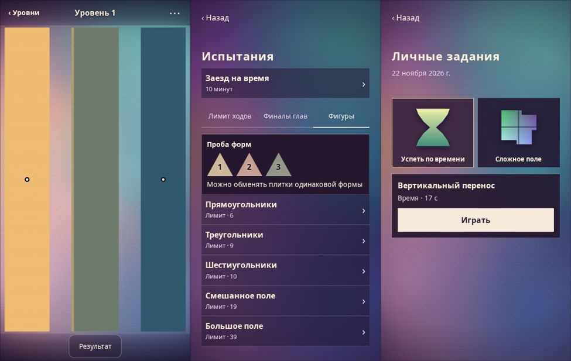

# Игровые меню 0.4.41 · независимая приёмка

**Обновлено для 0.4.42.** [Пять замечаний закрыты, два наблюдения по новой сцене](RECHECK-0.4.42.md). Ниже сохранены исходные сценарии 0.4.41.

22 ноября 2026. Проверены шесть поставок 0.4.36–0.4.41 относительно [ТЗ №13](https://github.com/DanilaH/hue-gradients/blob/90a1e72717551b56388a9cb21083567790011116/docs/design/menu-scenes/README.md). Ветка разработки [feat/m0-foundation, 89a4f3b](https://github.com/DanilaH/hue-gradients/blob/89a4f3beb49405c595950a1c08f6bd540180a908/package.json). Основной маршрут книги прошёл. Для полного закрытия интерфейсной части нужны правки ниже.

## Очередь исправлений

| Приоритет, sourceFeatureId | Воспроизведение и расхождение | Что принять |
|---|---|---|
| 1 · `poluson-result-reveal` · PARTIAL | Закончить 001 обычным обменом. В первый кадр approach под полем появляется отдельная скруглённая кнопка «Результат». Её не было до последнего хода. В этот момент footer opacity=1, у победного диалога opacity=0, его собственные команды disabled. То же видно в записи книги около **00:04,1**. [Условие показа footer](https://github.com/DanilaH/hue-gradients/blob/89a4f3beb49405c595950a1c08f6bd540180a908/src/game/mountGame.ts#L846). | Подавить появление «Результат» на всём протяжении проигрывания победы. Снять 001 и 006 в 1× от последнего жеста до доступной команды, включая нижний край. Сохранить индивидуальные прыжки, посадку, звук, общий порог проявления и защиту от раннего ввода. |
| 2 · `poluson-challenge-demo` · PARTIAL | На свежем профиле «Уровни → Испытания → Фигуры». Пара 1+3 отклонена сообщением «Можно обменять плитки одинаковой формы». При этом у 1, 2 и 3 один и тот же направленный вверх силуэт. В данных они соответственно triangle-nw, triangle-nw, triangle-se. [Маска всех треугольников](https://github.com/DanilaH/hue-gradients/blob/89a4f3beb49405c595950a1c08f6bd540180a908/src/game/game.css#L777). | Нарисовать настоящие формы и ориентации, используя геометрию игрового поля. 1+2 меняются местами, 1+3 явно различаются до нажатия и получают понятный отказ. Обе пробы оставляют сохранение игры прежним. |
| 3 · `poluson-dated-event-return` · PARTIAL | Вход через «Книги → событие 21 ноября». Перезагрузить страницу во время игры. Надпись корректно остаётся «Книги». Пауза → Начать заново → подтвердить. Теперь HUD говорит «Календарь», выход открывает «Задача дня» 21 ноября. При рестарте функция вычисляет источник из текущего меню, которое после восстановления уже другое. [Обработчик](https://github.com/DanilaH/hue-gradients/blob/89a4f3beb49405c595950a1c08f6bd540180a908/src/game/mountGame.ts#L387). | Сохранённый источник активной попытки передаётся при рестарте. Пройти обе ветки для одной даты с перезапуском приложения, рестартом задачи, выходом из паузы и выходом после решения. Для книги восстановить фокус события, для архива — день и месяц. |
| 4 · `poluson-loss-retry` · PARTIAL | Начать личное задание на время 22 ноября, дождаться поражения (в прогоне 17 секунд), оставить результат открытым. Перевести гражданскую дату на 23 ноября, монотонный таймер не менять. Кнопка «Повторить» осталась и запустила вчерашнее поле gradient-003. Условие даты проверяется при построении меню. [Результат](https://github.com/DanilaH/hue-gradients/blob/89a4f3beb49405c595950a1c08f6bd540180a908/src/game/mountGame.ts#L596) · [вход](https://github.com/DanilaH/hue-gradients/blob/89a4f3beb49405c595950a1c08f6bd540180a908/src/game/mountGame.ts#L408). | Проверять доступность на момент действия. Вчерашняя кнопка должна привести к актуальным заданиям или исчезнуть при смене даты/возврате из фона. В пределах того же дня повтор открывает ту же цель со свежей попыткой. |
| 5 · `poluson-angular-ui` · PARTIAL | У гнезда книги вычисленный фон rgba(38,24,45,0.91), у выбранного и обычного предмета заданий — alpha 0.91 и 0.867. Это интерактивные поверхности. [Книга](https://github.com/DanilaH/hue-gradients/blob/89a4f3beb49405c595950a1c08f6bd540180a908/src/game/game.css#L662) · [задания](https://github.com/DanilaH/hue-gradients/blob/89a4f3beb49405c595950a1c08f6bd540180a908/src/game/game.css#L707). | Кнопки непрозрачны во всех состояниях на светлом и тёмном фоне. Оставить мягкое цветное освещение вокруг них. |

## Художественная сверка

Книга работает как предмет: три реальных цветовых фрагмента и крупное гнездо читаются без списка целей. Личные задания остаются рядом тёмных карточек с плоскими вырезами. У выбранного предмета меняется рамка, он занимает тот же объём, что соседи. В календаре месячная сетка работает, а под ней дата и команда запуска — почти весь самостоятельный образ остаётся внутри маленьких ячеек. В «Прогрессе» полосы видны, но узкие и окружены текстовыми строками. Это оценка кадров по [двум концептам и подписям к ним](https://github.com/DanilaH/hue-gradients/blob/90a1e72717551b56388a9cb21083567790011116/docs/design/menu-scenes/README.md).

Первой художественной итерацией сделать один реальный экран «Личные задания»: крупный выбранный предмет с видимыми гранями, боковые предметы меньше, подписи доступны до выбора, короткая команда внизу. Показать рядом свежий профиль с двумя и развитый с тремя задачами при 390×740. Пробы шрифтов у разработчика представлены отдельной таблицей. Сравнить их непосредственно на заголовке книги, «006» и «3/4» с реальным светом за ними. Выбор гарнитуры остаётся у владельца.

## Что прошло и что именно проверяли

- **Свежая финальная сборка, Chromium 141.0.7390.37, сенсорная эмуляция 390×740.** Запуск упакованного index.html и его JS/CSS. Архив 0.4.41 SHA-256 `1edf3f54e25271b22402b03b5422cd49a11f181fff316578b2dbb173b701858c`. На свежем профиле выполнены касания на 001–006 с известными стартами из данных кампании. Число ходов 1, 2, 2, 4, 3, 7. После 005 войти через «Уровни → Альбом → Книги», открыть 006 с обложки 3/4, на результате нажать «К книге», дождаться 4/4, запустить `book-v1-dawn` и вернуться из паузы в «Тёплый свет». Сохранение не подменялось. Проверка относится к поведению меню и награды.
- **Фазы победы.** Независимый покадровый опрос 001: относительно первого наблюдённого кадра approach посадка примерно +844 мс, reveal +1377 мс, полностью доступный результат +1819 мс. Кнопка диалога блокируется до still. Дефект №1 относится к отдельному элементу HUD.
- **Календарь.** Новый профиль релизного веб-архива показывает «Календарь пока недоступен». Для отдельного прогона официальная демонстрационная 0.4.38 наполнила кэш тремя опубликованными тестовыми датами. Затем на том же origin запущен финальный пакет 0.4.41. Октябрь → 31-е → игра → назад восстановило 31 октября. Дефект №3 получен на финальном коде с тем же кэшем.
- **Редактор и экспорт.** Финальная сборка импортировала переданный JSON, показала «Моя композиция» и пять опор, открыла авторскую игру и вернула в тот же редактор. Переданный файл `05-poluson-019.png` независимо сравнен с целевой интерполяцией цветов уровня 019 на каждом из 288 600 пикселей. Расхождений RGB — 0.
- **Поставки разработчика.** Есть шесть разных веб-архивов и шесть MP4 по пакетам. MP4 книги 390×740, 8,77 с, видео 60 fps и звуковая дорожка AAC. У ролика сервисных экранов также есть AAC. Записи пакетов 2–5 содержат только видео. Просмотрены выборочные кадры каждого ролика. Протоколы разработчика описывают дополнительные сценарии, включая 10/15, 15/15 и проверку восьми PNG. [Исходный реестр сдачи](../../evidence/pr13-menu-trace.md).
- **Пока открыто.** Боевой источник Daily, физический Android, системное сохранение файла и ощущение вибрации на устройстве этим аудитом не подтверждены. На физическом телефоне повторить 006, паузу и возврат Back, сохранение обоев и касания по близким оттенкам.
