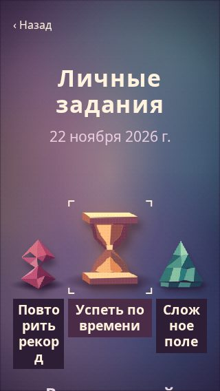

# Повторная приёмка меню · 0.4.42

**Все пять замечаний к 0.4.41 закрыты в проверенной веб-сборке.** Перепроверены исходные эпизоды на [193c212](https://github.com/DanilaH/hue-gradients/blob/193c212c0b7aad74a624a6fe807778ff821cbbcf/package.json) и упакованном веб-клиенте из поставки разработчика. SHA-256 архива: `edd7bd99808f95f35fba450807cac1fac32404e554ce683068e32698850aedac`. Chromium 141.0.7390.37, сенсорная эмуляция. [Исходные условия приёмки](README.md) · [протокол разработчика](https://github.com/DanilaH/hue-gradients/blob/193c212c0b7aad74a624a6fe807778ff821cbbcf/docs/evidence/pr14-menu-0.4.42.json).

| sourceFeatureId | Повторная проверка | Результат |
|---|---|---|
| poluson-result-reveal | Свежий профиль. Касаниями пройдены 001–006, считаны кадры до готовности результата. На 001 наблюдали 103 кадра, на 006 — 107. На всех шести уровнях 0 кадров с ранним footer и 0 с доступной командой диалога до конца проявления. На 006 вход из 3/4, семь обменов, «К книге», 4/4, запуск особой задачи и возврат в «Тёплый свет». | MATCH |
| poluson-challenge-demo | «Испытания → Фигуры». Контуры первых двух — верхне-левые треугольники, третьего — нижне-правый. Тапы 1+3 дают понятный отказ по ориентации, 1+2 принимаются. | MATCH |
| poluson-dated-event-return | Стендовый каталог 0.4.38 наполнил кэш. На этом профиле запускается 0.4.42. Дата 21 ноября: открыть отдельно из книги и календаря, перезагрузить приложение, через паузу подтвердить рестарт и решить поле. «К книгам» после результата вернуло фокус событию, «К календарю» — тому же дню. Дополнительно проверен выход из книги через паузу без победы и возврат в октябрьский архив на 31-е. | MATCH |
| poluson-loss-retry | 22 ноября истекли 17 секунд личного задания. Результат оставлен открытым, изменена гражданская дата на 23-е. «Повторить» ещё видно до нажатия. При нажатии открывается набор «23 ноября», вчерашняя попытка не стартует. Это предусмотренный в №14 вариант. | MATCH |
| poluson-angular-ui | У обычной и выбранной подписи предмета и пустых гнёзд книги вычисленные цвета RGB непрозрачны. Визуально вокруг силуэтов намеренно виден фон, текст расположен на сплошной поверхности. Дополнительные состояния focus, active и disabled записаны разработчиком. | MATCH |

## Новый экран заданий и две точечные правки

На 390×740 у свежего профиля два предмета, после прохождения 001 — три. Тень, отдельные грани, скобки и разница масштабов сделали роль выбранного предмета ясной. У профиля с тремя задачами ширина изображений в нашем замере 130/79/79 пикселей. Выбор гарнитуры остаётся у владельца.

| sourceFeatureId | Как воспроизвести | Как принять правку |
|---|---|---|
| poluson-personal-object-hit · PARTIAL | 390×740. Нажать на открытый фон над соседним предметом. На свежем профиле касание в 132 CSS px выше изображения переключило выбор, после 001 — в 135 px. Прозрачный верхний padding участвует в области нажатия. [Стили сцены](https://github.com/DanilaH/hue-gradients/blob/193c212c0b7aad74a624a6fe807778ff821cbbcf/src/game/game.css#L711). | Тап по картинке, её ближайшему окружению и подписи выбирает предмет. Нажатие в открытом фоне далеко выше силуэта оставляет выбор прежним. Сохранить удобную область у небольших боковых предметов. |
| poluson-personal-label-fit · PARTIAL | 320×568, масштаб текста 150% (корневой размер 150% в Chromium). В наборе из трёх выбрать часы. Подпись «Повторить рекорд» занимает четыре строки с одиночной «д». «Играть» доступна при прокрутке. | На том же профиле дать боковым предметам короткие подписи «Рекорд», «На время», «Поле» и под выбранным показывать полную цель, либо перестроить раскладку. Проверить все три выбора, слова читаются целиком. Сохранить имена для экранного диктора и доступность запуска прокруткой. |

**Границы.** Новый графический экран и жесты проверены в Chromium на 390×740, 320×568 и 568×320. На чистом профиле обычного архива по-прежнему нужен опубликованный источник. Стендовая проверка восстанавливает данные из кэша. Подписанный APK, настоящий телефон, системный Back, физическая вибрация и боевой Daily остаются отдельными пунктами приёмки. 
