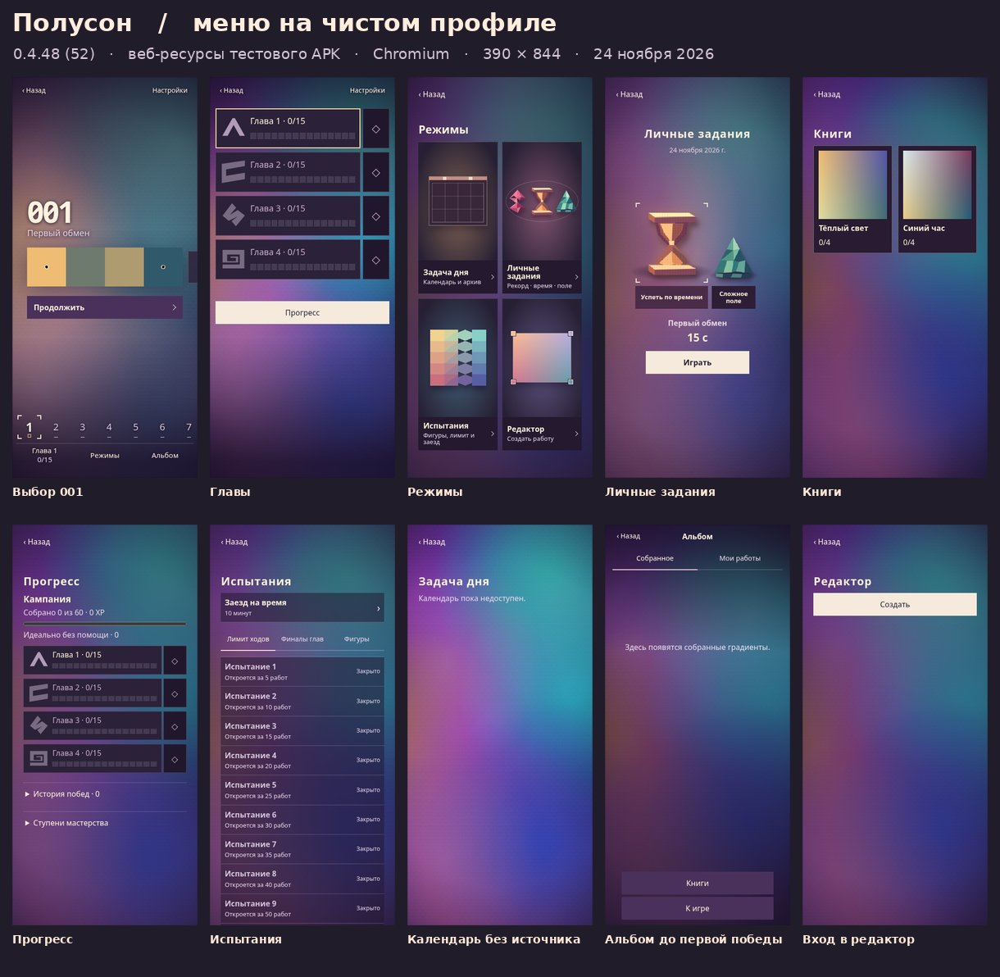

# Что осталось до выпуска «Полусна»

24 ноября 2026 · [игровая ветка 4d205b2](https://github.com/DanilaH/hue-gradients/tree/4d205b238ec9e04c9cf7a4fe33c04a6f4b9a52a8), 0.4.48 / 52. На ветке есть и новые «Режимы» из №19, и первый обмен из №21. Следующая видимая доработка нужна внутри меню. Самый существенный функциональный пробел для игрока — открыть «Задачу дня» и действительно сыграть сегодня.

Сняты десять экранов на чистом профиле в двух размерах. Открывали веб-ресурсы из подписанного тестового APK в сенсорном Chromium 153. Для заполненных состояний отдельно сверены предыдущие прогоны. Банк проверен повторным проигрыванием оптимальных решений и независимым подсчётом структур. Физическое устройство, опубликованная игра и человеческая трудность имеют отдельную приёмку. [390×844](menus-390.jpg) · [320×568](menus-320.jpg) · [условия, экранные тексты и подсчёты](measurements.json) · [версия и хеш APK](../../evidence/pr21-first-30-seconds-0.4.48.md)

## Меню глазами игрока

| Эпизод и что получилось | Что стоит изменить и как принять |
|---|---|
| **Выбор уровня, главы.** На 001 видны четыре полосы и опоры, номер читается, кнопка «Продолжить» под той же работой. Свайп 005→006 проверен в прошлой итерации. У глав разные знаки, но четыре почти одинаковые строки в «Главах» повторяются в «Прогрессе». | Селектор оставить. В прогрессе повысить визуальный вес текущей главы и ближайшей реальной работы. Одно касание приводит к обещанной задаче, возврат сохраняет главу. На 0/15, 9/15, 10/15 и 15/15 показывать фактическое следующее открытие. Числа и историю оставить доступными вторым планом. |
| **Режимы → личные задания.** Сама полка выразительна. Карточка всегда рисует три предмета и пишет «Рекорд · время · поле». Внутри при нуле побед ровно два предмета — песочные часы и кристалл. До первого рекорда третья цель физически невозможна. | Отрисовать на входе тот же доступный состав, что внутри. На свежем профиле два предмета; после появления доступного прошлого — три. Смена дня и возврат обновляют обе стороны. Просмотр карточки не выдаёт награду и не должен подменять уже выданное задание. [Безусловный цикл в меню](../../../src/game/metaView.ts#L463) · [подбор кандидатов](../../../src/domain/personal.ts#L84) |
| **Режимы → испытания.** Вход показывает разноцветное смешанное поле. После нажатия выбран «Лимит ходов». На новом профиле под доступным заездом стоят десять закрытых испытаний. Режим фигур доступен в соседней вкладке. | Если витрина показывает фигуры, открыть соответствующую вкладку с тем же полем и действием «Играть». Лимиты и финалы остаются соседними вкладками. Для закрытой задачи вывести одну ближайшую цель с её условием и превью по правилам видимости. Проверить нулевой профиль, первое открытие и возврат после игры. |
| **Редактор и альбом.** На входе в режим редактора виден холст с четырьмя углами. Следующий экран оставляет одну кнопку «Создать». Пустой альбом даёт текст по центру и две команды внизу. На заполненном профиле сами отпечатки работ уже выполняют роль меню. | В пустом редакторе сделать уже показанный холст действием создания, при наличии черновика — показать его и «Продолжить». Один осмысленный тап открывает редактирование, повторный вход сохраняет работу. В пустом альбоме показать место первого отпечатка и дать путь к текущей работе. После победы ровно это место занимает настоящая работа. [Переход редактора](../../../src/game/metaView.ts#L526) · [альбом](../../../src/game/albumView.ts) |
| **Личные задания, книги, победа.** Часы выражают цель «на время» до чтения подписи. В книге 3/4 видно, какой фрагмент хочется заполнить; на 4/4 игрок видит плоды действия. В принятом финале собираются сами плитки и только потом появляются команды. | Сохранить эти три образца для других меню. Подтвердить на устройстве различимость выбора, вес контакта и доступность кнопок после проявления. [Книга 3/4 → 4/4](../../evidence/pr13-book-006.json) · [посадка и 002](../../evidence/pr21-first-30-seconds-0.4.48.md) |
| **Календарь.** Плитка «Задача дня» выглядит доступной. В этом APK она привела к «Календарь пока недоступен» на обоих размерах. При открытии не было запроса к источнику каталога. На датированном стенде доступны календарная сетка, задача и возврат к выбранной дате. | Подключить источник к релизному кандидату. Для состояния без данных указать статус уже на плитке. После успешной загрузки показать реальное сегодняшнее поле. Если доступна только прошлая дата, обозначить «Архив» и открыть именно её. |

**Основание сравнения.** В I Love Hue на записи 50, 00:45–00:48 и 01:21–01:23, выбранная работа и соседние превью сохраняют связь с игрой. В I Love Hue Too на записи 43, 01:41–01:49, у главы центральный знак. В Color Puzzle на записи 29, 00:00–00:06, перед входом видны содержание режима и предмет будущей награды. В нашем проекте этот принцип удаётся, когда предмет на витрине совпадает с тем, что открывается. Конкретные композиции выше — предложения для «Полусна». Архивные версии — I Love Hue 1.3.1 (176), I Love Hue Too 2.1.1 (1013), Color Puzzle 6.13.0 (142). Версия видна непосредственно в ролике 43. Для остальных версия корпуса и версия ролика учитываются отдельно. [Кадры с таймкодами и метод сравнения](../../design/menu-and-board-feel/TRACE.md) · [аудит №19 с парными изображениями](https://github.com/DanilaH/hue-gradients/pull/19)

**Художественная приёмка.** Снять два непрерывных маршрута на 390×844 и 320×568 — испытание с полки до реального поля и создание первой работы до возврата к черновику. Проверить на пустом и заполненном профиле. Дать телефон человеку с заданием «начни доступное испытание с фигурами» или «создай свои обои» и посмотреть, где он вынужден угадывать. Полноэкранный dreamy PSX, свои рисунки и шкала шрифта 100% — решения владельца. Окончательный шрифт и художественную подачу утверждает владелец.

## Daily — два самостоятельных режима

**Общий календарь с архивом** — зафиксированное продуктовое требование «Полусна». Задачи готовятся заранее, редакция привязывает отпечаток к UTC-дате. Проверка принимает только целый опубликованный снимок. На стенде повторно проверялись одинаковая задача у двух профилей, смена дня, повреждённый ответ и доступ к прежней задаче офлайн. В этом проходе заново выполнены четыре теста сборщика, проверка банка и вход без источника в точных ресурсах APK. Для живого сервиса остался полный проход от публикации следующего дня до обновления на двух устройствах. [Порядок публикации и запас](../../DAILY_STAGING.md) · [архив и стенд](../../evidence/queue-d1-client-2026-11-21.json)

**Где повторяется контент.** В банке 30 разных цветовых наборов и 29 сочетаний сетки, опор и стартовой перестановки. Кандидаты 002 и 012 совпадают по всем трём, цвета различаются. Если сравнивать размер и положение опор, остаётся **десять схем**. У первой, второй и третьей десятки одинакова последовательность математических минимумов **4, 3, 5, 7, 7, 4, 10, 7, 8, 9**. Это порядок кандидатов, издатель может назначать даты в другой очередности. Новый авторский месяц в текущем клиенте сам не появляется. [Цикл десяти шаблонов](../../spec/tools/build_release_candidates.py#L69)

Для релиза принять 30 собственных задач и обеспечить запас минимум на 14 дней после старта по M6. При отборе разложить задачи по реальным датам, сравнить рядом одинаковые схемы и попробовать те же цвета на телефоне. Для повторяющихся дней кандидаты на замену — другая маска опор, иная геометрия, другой способ восстановить направление градиента. Проверить, что игрок действительно меняет способ решения. Сохранять уже опубликованные даты и начатые партии. Общий календарь не приписывать I Love Hue Too.

**Личные задания** — перенос Daily Divination из I Love Hue Too 2.1.1. Здесь важны доступность по прогрессу, вчерашние результаты и тип задачи. У оригинала порог 40 XP, локальная дата, Past, Present и Future. У нас на чистом профиле доступны два задания с нулём XP. В один момент времени 01:15 UTC экран личных заданий показал 24 ноября в Екатеринбурге и 23 ноября в Лос-Анджелесе. У Past в оригинале предел max(best, PerfectScore), у нас при неоптимальном рекорде требуется на один ход меньше. Наш Present включает запас времени сверх множителя, Future берёт первую закрытую главу, в оригинале проверены веса для трёх будущих кластеров. Кампанийный счётчик у нас равен числу пройденных работ; личная победа сохраняет отдельную отметку. [Исследование оригинала](https://github.com/DanilaH/mini-games-kit/blob/cf7cffc48b4925a897c6613949c771d3325713bb/research/games/hue/2026-11-16-apk-audit/I_LOVE_HUE_TOO.md) · [таймер, пул и повтор рекорда](../../../src/domain/personal.ts#L54) · [XP кампании](../../../src/domain/playerProgress.ts#L84)

| sourceFeatureId | Сверка и следующая проверка |
|---|---|
| h2-daily-open / h2-daily-date | Порог 40 XP **MISSING** в личном режиме. Правило локального дня **MATCH** в проверенных двух часовых поясах. В реестре устранена прежняя ошибочная ссылка на общий UTC-календарь как основание этих двух механик. Прежде чем менять порог, сравнить темп набора 40 XP на наших 60 работах и оформить выбор владельца. |
| h2-daily-past / h2-daily-present / h2-daily-future / h2-daily-history | **PARTIAL**. Есть три типа и история. Наши лимиты, выбор из пула и защита от повторов отличаются. Проверить один старый рекорд выше минимума и на минимуме, обычное поле и финал для таймера, выбор будущей главы на профилях с одной и несколькими будущими главами. |
| h2-daily-reward / h2-daily-share | Отдельный +1 XP за личную победу **MISSING**. Для share трёх результатов есть кодовая цепочка оригинала, фактический системный результат и наш аналог требуют отдельного прохода **UNKNOWN**. Выпуск календаря не закрывает эти строки. |
| cp-mode-selection / cp-locked-reward-preview / mt-m09 | Входы работают. Соответствие именно показанного предмета фактическому первому экрану **PARTIAL** для испытаний и личных заданий нового профиля. Выразительность символов на телефоне **UNKNOWN**. Проверить маршруты из первого раздела. |

## Кампания — годный каркас, содержание ещё нужно сыграть

Все 60 стартов решаемы. Первые 15 сохраняют исходные определения, в начале объясняются ряд, вертикаль и углы. Кампания даёт четыре главы по 15; первые пять идут последовательно, далее можно выбирать; следующая глава открывается при 10/15 предыдущей. Есть короткие передышки. В главах 2–4 метка передышки каждый раз стоит на 5-м, 8-м и 13-м месте. Это авторская расстановка, её удачность предстоит проверить игрой. [Загрузчик банка](../../../src/domain/levels.ts) · [права доступа](../../../src/domain/progression.ts) · [все 60 и цветовые предупреждения](../../spec/candidates/README.md)

| Что пересчитано по поставленным уровням | Результат и смысл |
|---|---|
| Форма и опоры | Все 60 обычных кампанийных полей прямоугольные; 34 сочетания размера и точной маски опор. Треугольники, шестиугольники и смешанные поля уже реализованы в испытаниях. В корпусе I Love Hue 325 прямоугольных, 315 шестиугольных и 315 треугольных определений. Формы входят в основной контент. **h1-geometry / h2-shape-swap — PARTIAL** на маршруте кампании. [Исходная база](https://github.com/DanilaH/mini-games-kit/blob/cf7cffc48b4925a897c6613949c771d3325713bb/research/games/hue/2026-11-16-apk-audit/I_LOVE_HUE.md) · [наши формы](../../../src/domain/shapeLevels.ts) |
| Старт | У всех 60 один цикл среди подвижных плиток. В Hue Too один цикл формируется **на каждую группу совместимых форм**. В Hue 1 исправляются уже правильно стоящие плитки; циклов может быть несколько. **h1-shuffle — PARTIAL**; **h2-perfect — MATCH** для математического расчёта на наших однотипных полях. Единый цикл имеет основание; одной группой прямоугольников разнообразие источника не исчерпывается. Трудность различения соседних цветов проверяется отдельно в игре. |
| Повторы | На 60 задач приходится 56 разных сочетаний сетки, опор и стартовой перестановки. Например, 020, 043, 058 идентичны по всем трём, с разными палитрами. Для 027, 037, 053 и 060 валидатор отмечает близкие цвета. Эти четыре задачи — очередь на устройство, причислять их к браку по одному числу преждевременно. **h2-perceptual — UNKNOWN** для влияния расчёта в оригинале на выдачу. [Исследование цвета](https://github.com/DanilaH/mini-games-kit/blob/cf7cffc48b4925a897c6613949c771d3325713bb/research/games/hue/porting/COLOR_AND_AD_TRIGGERS_2026-11-23.md#h2-perceptual) |

Первая редакторская итерация — сравнить 020/043/058 и сыграть четыре поля с близкими оттенками на двух дисплеях. Затем на копии одного повторяющегося фрагмента после 015 опробовать уже имеющиеся формы. Проверить понятность первого разрешённого обмена, время, ошибки, помощь и следующий сознательный ход. Первые 15, права и сохранённые точные старты сохраняются. Новому варианту присвоить собственную версию, проверить открытие старой партии, рекорд и альбом. По итогам пройти все 60 и подписать решение по каждому полю. 60/60 и 30/30 оптимальных автоматических повторов показывают корректность правил. Они не измеряют удовольствие или удержание.

## До полного выпуска

| Порядок | Готовый результат для проверки |
|---|---|
| 1. Меню и обещания на входе | Новый профиль, профиль с первой победой и с черновиком. Предмет ведёт к ожидаемому действию. Сначала испытания, личные задания и вход в редактор, затем прогресс и пустой альбом. Сравнить запись с №19 и дать владельцу на художественный просмотр. |
| 2. Кампания и ежедневный банк | Редакторская таблица по 60 + 30 с отпечатком, устройством, наблюдением и решением. Контент для новых профилей версионирован, старые попытки открываются с прежней раскладкой. |
| 3. Живой календарь | На подписанном кандидате и в Яндекс DRAFT два чистых профиля видят один UTC-слот. Пройденный день доступен офлайн, после полуночи приходит следующий, испорченный ответ сохраняет кеш. Есть назначенные даты и следующая партия в запасе. |
| 4. Фактический релиз-кандидат | Физические Android-устройства и опубликованный тестовый веб-хост. Проверить жест/цвет/звук/вибрацию, повторный запуск с сохранением, обновление поверх старой версии, системное сохранение/передачу одних полноэкранных обоев, паузу и возврат. Проверить подключённые рекламные места и доставку событий через реальные адаптеры, отказ и повтор. Тестовая подпись APK и вызов SDK в модели не подтверждают приёмку магазина. [Шлюз Яндекса](../../YANDEX_RELEASE_CHECKLIST.md) · [реклама и покупки](../../evidence/queue-f1-2026-11-20.json) |
| Отдельно от качества локальной игры | В полной очереди переноса ещё есть публикация/модерация работ, рейтинги, реальная выборка для сравнения мастерства, товары/награды и правила нового цикла. У каждого своя внешняя зависимость или решение владельца. Энергия исключена. Облако и аккаунты на паузе; живой общий календарь этого решения не требует пересматривать. [Внешние зависимости и статусы](../../porting/DELIVERY_QUEUE.md) |

Это исследовательская передача. В отчёте исправлена атрибуция Daily. Новая геометрия, пороги и художественные изменения проходят отдельную разработку и приёмку. Авторские календарь, архив, редактор, одиночные обои и dreamy PSX сохраняют происхождение в решениях проекта. Совпадение с очередным конкурентом само по себе не даёт оснований их отменять.
