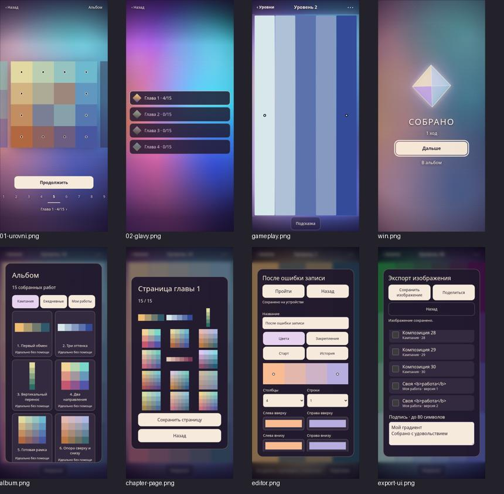
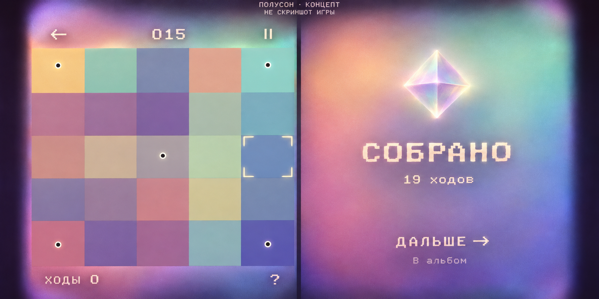

# Полусон · Что игрок должен почувствовать

Независимый разбор 0.4.4 · 19 ноября 2026 · рабочая ветка `a0de06a`

**Главная возможность — дать игроку унести с собой тот цвет, который он только что собрал.** Сейчас на поле 5 он двигает большие матовые плитки. Через мгновение получает ту же сиреневую призму, что и за синее поле. Ещё через тап видит бежевые вкладки и подписи «Идеально без помощи» под миниатюрами. Предлагаю сделать из каждого уровня свой световой отпечаток. Он читается в руках во время обмена, освещает призму на победе и остаётся узнаваемым среди работ в альбоме.

*Верхний ряд — выбор, главы, игра и победа. Нижний — альбом, страница главы, редактор и экспорт. Последние два кадра взяты из предыдущего прохода. Их редакторские формы и разметку экспорта сверил с текущей веткой. «После ошибки записи» — название из тестового набора.*

## Какие решения действительно есть у аналогов

| Что видно или описано | Что перенести в «Полусон» |
|---|---|
| **I Love Hue.** Для продолжения показывают крупную композицию, за краем виден следующий лист. Надпись Continue стоит непосредственно под работой. Экран главы отличает один большой цветовой знак. В результате уместились символ, краткая статистика и переход. | Карусель уже сделана. Пусть тап по центральному превью тоже продолжает игру. Выделить каждую главу своим знаком. После победы оставить игрока на цветах этой задачи. |
| **I Love Hue Too.** На выборе и в игре мозаика узнаваема по одному силуэту. На спокойном окружении хорошо читается тонкий HUD. Выбранная тапом плитка пульсирует, второй тап меняет её местами, повторный отменяет выбор. Подсказка в меню партии. | Перенести устойчивое состояние выбора и доступ к подсказке. При переходе с превью на поле на мгновение сохранить те же цвета и ориентацию. Прямоугольные доски «Полусона» хорошо подходят для такого перехода. |
| **Colour Puzzle.** На захвате выбора режима и уровня видно сетку пронумерованных ячеек и замков. Она хорошо отвечает на вопрос «сколько пройдено», но впервые выбранная задача мало чем выделяется. | Плотный обзор использовать для *собранной главы*. Для следующего хода достаточно нынешнего большого превью. |
| **Daily Divination в Too.** Есть короткая церемония и прямой путь к испытаниям. Разработчик также описывает эмбиентную синтезаторную музыку во время игры. | Взять принцип необязательного ритуала. Достаточно одной цветной печати дня и одного тапа в задачу. Конкретные ноты обмена, длительности и слои ниже — наш звуковой дизайн. |

[Сравнительная подборка экранов](https://chatgpt.com/library?file_id=libfile_fde3_f-2b39f5c964548191a97c8a7e16518841_2841ca9da26c8191b7a266fa9b41a810&account_id=personal) · [I Love Hue](https://i-love-hue.com/) · [Справка I Love Hue Too](https://i-love-hue.com/too/faq/) · [Описание музыки от Zut Games](https://apps.apple.com/us/app/i-love-hue-too/id1395332051)

## Где возникает ощущение шаблона

В CSS одна и та же кремовая прямоугольная кнопка со скруглением 12 px обслуживает и выход, и выбор режима, и сохранение. Большинство экранов наследуют тёмный диалог шириной до 420 px с обводкой и прокруткой. Под ним просвечивает размытое поле. Так возникает ощущение, будто коллекция и мастерская — две формы поверх настоящей игры. Полноэкранный выбор уровня уже показывает, насколько лучше может выглядеть тот же материал.

На экране глав четыре почти одинаковые тёмные полосы собраны в центре яркого тумана. На поле всё наоборот — почти всю площадь занимает непрозрачное игровое полотно. Свет от пальца считается в фоне, но на значительной части жеста его физически закрывают плитки. Повышение интенсивности фонового эффекта главным образом осветлит меню. Для ощутимой реакции на ход нужен локальный свет *у самой переносимой плитки*.

В исходнике жеста есть ещё одна конкретная деталь. Пока палец движется, отрисовка сначала рисует всю старую доску, а затем ещё раз рисует взятую плитку под пальцем. До отпускания остаётся цветной двойник. Пустое матовое гнездо на старом месте даст игроку ясное чувство, что он взял предмет.

## По экранам и состояниям

| Экран | Сейчас | Изменение и причина |
|---|---|---|
| Первый вход, возврат | Игра сразу открывает поле. В первом задании есть одна инструкция. | Сохранить прямой вход. На первой неподвижной плитке один раз пояснить точку. При возвращении коротко проявить сохранённую раскладку. Вход не должен задерживать первый жест. |
| Выбор уровня | Центр и фрагменты соседей читаются, есть свайп, номера, кнопка. У закрытой задачи виден пустой тёмный прямоугольник. | Тап по композиции = действие под ней. Различать тап и свайп; отпускание после листания не запускает уровень. Для закрытой — матовое стекло с едва видимым знаком главы и одним условием открытия, без подсказки о раскладке. |
| Главы | Четыре тёмные строки, маленькие ромбы, мало различий. | Четыре крупных образца плёнки на общем фоне. В каждом собственная форма засветки и 15 тонких засечек по краю. Открытая глава заполняется своими оттенками. Название и число оставить текстом. На малой высоте — компактная сетка 2×2 с доступным порядком фокуса. |
| Поле, выбор, отмена | Большие плитки, крепления, контрастная рамка, drag и tap–tap. Дотягивание обмена уже занимает 150 мс. | При тапе зажечь четыре коротких уголка; на клавиатуре сохранить отчётливый фокус. При drag освободить старое место, показать короткую тень и свободный верхний край плитки. Допустимый адрес показать скобками. Отпускание вне поля возвращает её в гнездо. Одинаковый отклик на любой законный обмен. |
| Линейные уровни | Одна строка растягивается в высокие полосы; в превью эта же работа выглядит тонкой лентой. | Полосы — удачный образ жалюзи. На входе растянуть ленту из превью в игровую область за 180–220 мс. Оставить крупную область для жеста. Проверить узнаваемость и для вертикальной ленты. |
| Пауза, настройки, помощь, сброс | Меню по многоточию, три переключателя и перезапуск. «Подсказка» отдельной постоянной кнопкой под полем. | Подсказку перенести в короткое меню; в открытом решении оставить явное «К игре». До первого использования дать понять, что это просмотр *всего* решения и попытка будет отмечена. Заново подтверждать отдельно. Звук, вибрация и движение — три строки с понятным состоянием. Подложку поля здесь уместно приглушить. |
| Победа и открытие главы | Поле растворяется; стандартная четырёхгранная призма, число ходов, кнопка и альбом. С цветами уровня связан фон, SVG-граням заданы постоянные цвета. | Оставить финальную раскладку различимой ~300 мс. Четыре краевых цвета переходят на грани. Узкий блик один раз пересекает ребро. «Дальше» доступно сразу после сохранения. При открытии главы на одну строку проявляется её знак. «В альбом» открывает именно заработанную работу. |
| Альбом, пустое и заполненное состояния | Три равноправные вкладки, в том числе пустая ежедневная. Повторяется подпись о мастерстве. | Полноэкранный контактный лист. Между отпечатками тонкие поля. Видны цвет, название или номер. Особый результат отмечает насечка с доступным описанием. Подробности — по касанию. Пустая коллекция предлагает сыграть, собственная — создать. Daily появляется с доступным контентом. |
| Карточка, копия, страница главы | У работы несколько равных кнопок и строки о рекордах, включая отсутствующий результат. Страница 15/15 уже складывает миниатюры в коллекцию. | Открывать выбранный отпечаток из его места в сетке. Одно главное действие «Сохранить PNG». Повтор и «Сделать свою» — в меню. При копировании сразу открыть редактируемую копию с возможностью переименовать. Страницу 15/15 оформить цельным листом и сохранять одним действием. Back возвращает к тому же месту в альбоме. |
| Редактор, палитра, закрепления, старт | Сразу видны имя, режимы, размер, подписанные углы, кнопки и технические пояснения. Шаблон формы сильнее самой композиции. | Поле занимает центр. Четыре цветных ушка расположены у соответствующих углов; тап открывает только редактирование этого угла. Верх — имя; низ — «Испытать». В инструментах доступны размер, закрепления и перемешивание. При закреплении тап прямо по клетке ставит точку. На одной строке показывать только работающие маркеры. Невалидную задачу можно сохранить, у «Испытать» указать одну причину. |
| История и авторская игра | Список версий, статусы прохождения, режим отдельной попытки. | Версии показать лентой цветовых миниатюр с номером, отметкой проверки и выбором ветки. Авторская партия использует поле кампании. На победе главное «В редактор», в мастерской видна отметка именно сыгранной версии. |
| Экспорт, системная отправка | В расширенной форме макет, чекбоксы, подпись, сохранить, отправить, назад; в захвате прокрутка оставила превью за пределами экрана. | Чистый PNG — сразу из карточки. Для нескольких работ сначала выбрать их касаниями в альбоме, затем увидеть настоящий результат и сохранить. В расширенном экспорте превью остаётся видимым при смене макета. Отмена системного окна сохраняет выбор. |
| Daily и архив | В 0.4.4 видна пустая вкладка. Игровой календарь в этой сборке ещё впереди. | Одна печать сегодняшней палитры рядом с кампанией. Касание разворачивает доску. Архив — месячный лист маленьких работ с датой, пропущенный день доступен по правилам архива. Печать можно пропустить сразу. |
| Облако, конфликт, ошибка сохранения | Восстановление локальной записи предусмотрено. Облачные экраны — дальнейший этап. | Обычный успешный сейв проходит тихо. При конфликте показать две различимые миниатюры, время и ходы. При ошибке локальной записи сохранить поле в контексте, назвать выполнимое действие и дать повторить запись. Успешная вспышка и звук выдаются после подтверждения. |

## Свет, который выглядит как «Полусон»

*Визуальная цель владельца. По краям есть темнота, но свет внутри неоднородный, почти молочный. Мягкость окружает плитку, её собственный цвет читается ровно.*

1. **Свет, застрявший в матовом стекле.** При подъёме плитки оставить узкий свет по задней кромке в направлении, противоположном движению. При отпускании он гаснет за 100–150 мс. Соседние цвета видны через освобождённое гнездо лишь как приглушённый тон. Сигнал работает даже когда большая часть фона скрыта доской.
2. **Засветка плёнки вместо одинаковых цветных кругов.** Сохранить действующий низкоразрешённый Canvas2D. Две бесшовные монохромные маски с разной крупностью и медленным взаимным сдвигом модулируют яркость уже существующего тумана. На маленькой площади добавить тёплый светлый центр и неровный край. Уменьшить постоянную примесь фиксированной палитры: сейчас в окрашивании каждого облака её доля 43%, плюс три фиксированных блика. Сравнить две очень разные доски — синюю и янтарную — в одинаковой фазе движения.
3. **Пыль проходит через свет.** Для пробы 5–8 едва видимых точек по краям выбора, альбома и победы. Они становятся заметны лишь в светлой зоне. Во время drag оставить только реакцию кромки. Убрать пыль из варианта, если игрок первым замечает её. Количество и длительности здесь — настройки первого сравнения.
4. **Призма как отпечаток.** Сделать цвет граней параметром материала и один короткий перелив по маске ребра. При переходе в альбом призма сжимается в размер миниатюры, там раскрывается прямоугольник с точным градиентом. В режиме уменьшенного движения показать два устойчивых состояния мгновенно. Этим же языком работает разблокировка главы.

Эффект PSX здесь даёт контраст между грубой сеткой освещения и мягким краем света. Уже есть буфер до 160×240, Bayer 4×4, blur 1,05 px и ограничение фонового рендера 24 кадра/с. Сначала заменить форму и распределение света в этом слое. Дешёвый эксперимент — четверть оборота блика на призме и зерно только в полутонах. Фоновая частота отдельная от движения плитки под пальцем. Цвет центров клеток, текст и экспортный PNG остаются точными.

**Шрифт.** Сейчас используется системный sans. Я бы проверил два варианта кириллической типографики на реальных словах «Собрано», «Главы», «Сохранить PNG» и числе «15». Первая проба — тёплая антиква Spectral только на именах глав и победе + спокойный интерфейсный Golos Text. Контроль — один Golos Text с тем же кеглем, ритмом и композицией. Решение принимать на малом телефоне после чистки кнопок. Ретро здесь уже передают свет и материал.

## Что поручить генерации

| Заготовка | Как использовать и принять |
|---|---|
| Два листа оптических текстур | Сгенерировать крупноплановые бесцветные засветки на зернистой фотоплёнке, с мягкими пятнами разной плотности, без букв и рамок. Выбрать два разных масштаба, обесцветить, сделать бесшовными и прогнать в движении. Цвет задаёт игра. |
| Четыре характера глав | Одна серия кадров одного материала в боковом свете — опал, дымчатое стекло, перламутр, рассечённая призма. Из каждого отобрать один узнаваемый силуэт. Упростить вручную и проверить распознавание в 32 px и монохроме. Это материал для выбора символа, а не фон для каждой задачи. |
| Призма | Сгенерировать лист проб освещения *одной и той же формы*. Из выбранного кадра художник берёт распределение белого света и матовость, грани строятся процедурно. В игре один объект принимает палитру всех уровней. |
| Аудиофактуры | Получить несколько сухих дублей контакта матового стекла с деревом и несколько длинных записей тихого воздуха. Отобрать, подрезать транзиенты, собрать оригинальные варианты, зафиксировать источник и права. Для начала достаточно процедурного эскиза ниже. |

Плитки, состояния фокуса, интерфейсный текст, иконки управления, миниатюры собранных работ и итоговый PNG строятся из игровых данных и вектора. Самая дорогая ошибка здесь — заставить генератор заново рисовать то, что игрок буквально только что собрал.

## Как должен звучать ход

[Звуки 0.4.4, реконструкция](media/base.mp3) · [Новый звуковой эскиз](media/proposed.mp3)

*Одинаковая последовательность из четырёх обменов и победы. Первый эскиз воспроизводит формулы 0.4.4, второй — моя проба матового контакта, воздуха и стеклянного хвоста. Пики выровнены для сравнения. Это синтезированные эскизы, запись устройства и согласование финального микса ещё предстоят.*

| Когда | Что слышит игрок |
|---|---|
| Открытие игры и пауза | При включённом звуке и после допустимого жеста медленно возникает тихий слой воздуха. Он продолжается сквозь переходы между полем и альбомом без повторного вступления. При сворачивании, потере аудиофокуса и рекламе плавно гасится; возврат не воспроизводит пропущенные события. |
| Взять, тянуть, отменить | Основной сигнал дают движение, тень и скобки. При быстром переборе не звучит серия кликов. Касание закрепления получает локальный визуальный отклик. |
| Законный обмен | Один короткий сухой контакт с быстро гаснущим обертоном. Три близких варианта тембра по кругу, независимо от верности хода. Одна лёгкая вибрация при включённой настройке. Короткий звук начинается сразу после подтверждения записи, без ожидания конца анимации. |
| Последний обмен | Один звук вместо наложения обмена и фанфары. Тот же контакт переходит в раскрывающийся интервал; блик на ребре совпадает с появлением верхнего тона. «Дальше» доступно сразу, хвост не блокирует управление. |
| Листание, редактирование, использование PNG | Тихий шелест только при завершённой смене листа, если тест покажет пользу. На движение слайдера, пролистывание номеров, Back, отмену системного диалога и автосейв — тишина. Для музыки и эффектов предусмотреть раздельное отключение, если постоянный слой войдёт в игру. |

## В каком порядке проверять

1. **Сначала вертикальный срез «взял → обменял → собрал → сохранил».** Один уровень с тёплой палитрой и один с холодной. Убрать двойник плитки, привязать призму к палитре, открыть отпечаток из результата и сохранить чистый PNG. Записать обе партии. По одному беззвучному клипу должно быть видно, откуда взяли плитку и какую работу получили.
2. **Потом главы, альбом и редактор.** Взять уже написанный план интерфейса и добавить к нему материал главы, контактный лист и управление углами. Задания для наблюдения: продолжить начатую игру, найти только что собранную работу, поменять верхний левый цвет своей композиции, сохранить PNG. Записать лишние возвраты, промахи и места, где пришлось объяснять. Прямой PNG — один запрос из открытой работы плюс системный диалог, если он нужен.
3. **Последними подобрать туман, пыль и звук.** Сравнить текущую сцену и новую на одних ходах; один прогон без звука, один с музыкой и эффектами. Отдельно проверить 20 быстрых обменов, выход в фон и возврат, тихий динамик телефона, наушники и уменьшенное движение. Зафиксировать время кадра на слабом устройстве, не принимать эмулятор за замер телефона. Сравнить цвет центра каждой плитки с эталоном, особенно на уровнях 27, 37, 53 и 60. При просадке сначала снять частицы и второй световой слой.

**Основание разбора.** Сверены ветка 0.4.4, игровой рендер, маршруты, CSS, формулы звука, кадры Chromium, последовательность из записи 0.4.4 и материалы Android-захвата конкурентов. По Too использованы опубликованные кадры и справка. Свежая локальная попытка запуска Chromium завершилась до открытия приложения из-за ограничения сокетов. Оценка опирается на сохранённый проход и код. Тактильность, реальную громкость и батарею на физическом телефоне этот разбор не подтверждает.

[Исходники проверенной версии](https://github.com/DanilaH/hue-gradients/tree/a0de06a7136516f1a420bd316ca9654e27ca64d1) · [Протокол записи 0.4.4](https://github.com/DanilaH/hue-gradients/blob/a0de06a7136516f1a420bd316ca9654e27ca64d1/docs/evidence/dream-atmosphere-2026-11-19.json) · [Имеющийся план доработок](https://github.com/DanilaH/hue-gradients/blob/a0de06a7136516f1a420bd316ca9654e27ca64d1/docs/UI_REFINEMENT_PLAN.md)
