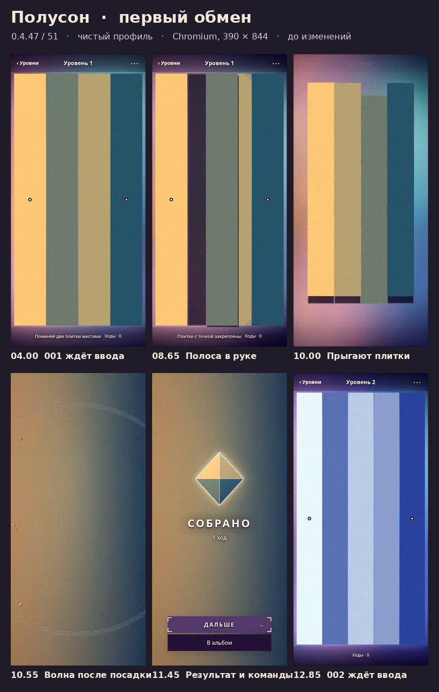

# Полусон · первые 30 секунд

ТЗ разработчику от 24 ноября 2026. Исходная сборка **0.4.47 / 51**, ветка [feat/menu-and-board-feel на 2767344](https://github.com/DanilaH/hue-gradients/tree/2767344a7c360c4dcc72d0b36145d046f3ed5442). [№20](https://github.com/DanilaH/hue-gradients/pull/20) вошёл в эту базу. Первый проход [№19](../../evidence/pr19-art-first-pass-0.4.47.md) уже виден в игре. Финал V1.4 на 006 принят [владельцем](../../PROJECT_DECISIONS.md).

**Результат для игрока.** Впервые открыв 001, человек видит четыре цветные полосы, находит две свободные, меняет их местами и видит, каким получился его градиент. После «Дальше» он пробует тот же жест на пяти полосах другого цвета. Тридцать секунд — окно наблюдения за человеком. Игрок может сколько угодно смотреть на поле или результат.

**Изменение в этой поставке** — уточнить одну строку на 001 и один раз показать на самом поле, что полосу можно взять. Уже работающие выбор, drag, посадка, победа и открытие 002 входят в приёмку. Сначала реализовать этот эпизод, потом передать запись и тестовый APK. Остальные экраны №19 идут своей очередью.

## Что происходит сейчас

[Видео 001 → 002, 14,12 с, 1×, без звуковой дорожки](baseline-001.mp4) · [шесть кадров в крупном размере](baseline-frames.jpg) · [замеры трёх независимых профилей](baseline.json)

| Момент в видео | Что видит и делает игрок в 0.4.47 |
|---|---|
| 00:04, до касания | Сразу открыто игровое поле 001. Внизу «Поменяй две плитки местами». На крайних полосах по точке. В отдельном замере через 4,7 с ожидания то же приглашение и та же перестановка. Самостоятельный знак на свободной полосе отсутствует. |
| 00:08,65, палец на полосе | Взятая полоса следует за пальцем. Между неподвижными соседями видно тёмное место, откуда её взяли. Именно этот знакомый образ используем для первого приглашения. В отдельном прогоне отпускание на опоре оставило ноль ходов. |
| 00:10,00 → 00:10,55 | После настоящего обмена отдельные полосы подскакивают и садятся в разное время. Затем на полноэкранном градиенте видна расходящаяся волна. Команд в этот момент не видно. |
| 00:11,45 → 00:12,85 | «Собрано», один ход и две команды. Тап по «Дальше» открыл 002 с пятью полосами. В отдельном прогоне первый обмен на 002 сохранился после перезагрузки. |

Видео снято через обычный корневой вход веб-сборки в Chromium 153, 390×844, на новом профиле. Действия выполнял сценарий через сенсорный ввод браузера. Замеры — отдельные сессии, их часы отсчитываются с навигации. Видео показывает кадры, журнал фиксирует состояния и вызовы API. Самостоятельность новичка, слышимый звук и силу вибрации на телефоне ещё предстоит проверить.

## Откуда взято поведение

| sourceFeatureId | Что установлено и на чём основано | Статус в 0.4.47 и действие |
|---|---|---|
| h1-pins | I Love Hue 1.3.1 (176), архивный кадр hue1-instructions и разбор createBoard. На первом учебном поле неподвижные цвета помечены точками. [Архив кадров](https://github.com/DanilaH/mini-games-kit/blob/cf7cffc48b4925a897c6613949c771d3325713bb/research/games/hue/2026-11-16-apk-audit/evidence/feel-ui-ux-observations.json) | MATCH для 001 в Chromium. Касание левой опоры объясняет точку; при сбросе на опору оба цвета и ноль ходов сохраняются. [Ввод](https://github.com/DanilaH/hue-gradients/blob/2767344a7c360c4dcc72d0b36145d046f3ed5442/src/game/PuzzleScene.ts#L225) |
| h1-swap | I Love Hue 1.3.1 (176), воспроизведённые tap–tap и drag. В кадре hue1-final-settled выбранная плитка выступает над соседями. [Архив жестов и кадров](https://github.com/DanilaH/mini-games-kit/blob/cf7cffc48b4925a897c6613949c771d3325713bb/research/games/hue/2026-11-16-apk-audit/FEEL_UI_UX.md) | MATCH для обоих жестов в Chromium. Освобождение над второй подвижной полосой завершает 001 за один ход. [Обработка двух касаний](https://github.com/DanilaH/hue-gradients/blob/2767344a7c360c4dcc72d0b36145d046f3ed5442/src/game/PuzzleScene.ts#L244) |
| h1-pin-dialog | I Love Hue 1.3.1 (176), game-scene.lu 174–181, параметр десяти учебных уровней. После третьего срабатывания оригинал показывает объяснение и сбрасывает счётчик. [Строка реестра](https://github.com/DanilaH/mini-games-kit/blob/cf7cffc48b4925a897c6613949c771d3325713bb/research/games/hue/porting/SOURCE_FEATURES.json) | PARTIAL. У нас первая опора даёт надпись, третье касание открыло «Закреплённые плитки» на 320×568. Наш счётчик насыщается на трёх. В этом пакете сохраняем это поведение. [Счётчик](https://github.com/DanilaH/hue-gradients/blob/2767344a7c360c4dcc72d0b36145d046f3ed5442/src/domain/workspace.ts#L244) |
| poluson-first-swap-cue | Новая авторская проба для «Полусна». Вид взятой полосы подсмотрен в нашей сборке на 00:08,65. Показ свободной полосы после ожидания предлагается здесь впервые. | MISSING для приглашения на самом поле. До первого обмена есть общая строка и отклик на реальное касание. Находит ли новичок свободную пару по ним — UNKNOWN. Проверка на телефоне ниже. [Текущая строка](https://github.com/DanilaH/hue-gradients/blob/2767344a7c360c4dcc72d0b36145d046f3ed5442/src/game/mountGame.ts#L965) |
| poluson-win-landing / poluson-result-reveal | Постановка владельца V1.4. Ориентир на ясный следующий шаг также виден в hue1-last у I Love Hue 1.3.1. В записи Color Puzzle, файл 39, 00:29–00:31 виден чистый рисунок. Версия корпуса Color Puzzle 6.13.0 (142), номер сборки записи не установлен. [Кадры записей](../menu-and-board-feel/TRACE.md) · [V1.4](../../evidence/v14-dreamy-psx-2026-11-22.json) | MATCH для очередности и доступности команд в веб-эпизоде 001. Отдачу, одновременное проявление панели с командами и раздельные прыжки сохранить. [Отрисовка отдельных плиток](https://github.com/DanilaH/hue-gradients/blob/2767344a7c360c4dcc72d0b36145d046f3ed5442/src/game/PuzzleScene.ts#L350) |
| poluson-contact-sound | Авторский акцент при подтверждённой победе. [Связь с посадкой](https://github.com/DanilaH/hue-gradients/blob/2767344a7c360c4dcc72d0b36145d046f3ed5442/src/game/mountGame.ts#L1084) | PARTIAL. В обычном браузерном прогоне ровно один вызов буфера 240 мс и один запрос вибрации 22 мс, оба на посадке. Отдельный штатный прогон проверил выключенный звук и выключенную вибрацию. Физический отклик проверяется на APK. |

## Что реализовать

1. **До первого ввода.** На чистой кампанийной 001 заменить инструкцию на **«Поменяй местами две полосы без точек»**. Взять существующую строку под полем, сохранить шрифт 100%, обе опоры и кнопку помощи. На ширине 320 px допустим перенос по словам. Подпись целиком видна, поле и зона пальца остаются на месте при смене строки. При первом касании опоры показать существующее «Плитки с точкой закреплены». Если игрок всё ещё на том же открытом поле и нет более свежего сообщения, вернуть инструкцию через 2 с. Диалог третьего касания приоритетнее обеих строк.
2. **Если игрок смотрит.** На 001 после **4 с** непрерывного ожидания на готовом к вводу поле один раз слегка сдвинуть вправо *вторую полосу слева* (позиция 1). На миг виден её собственный тёмный край со стороны гнезда. Две фазы первой пробы — **140 мс на 3 CSS px**, затем **220 мс обратно** с мягкой остановкой. Соседи сохраняют позиции, точки остаются на месте. Указание заканчивается в исходной геометрии. Эти числа — стартовая настройка нашего прототипа. Роль подсказки проверяется по первому действию человека. Необходимую информацию при отключённых анимациях даёт строка с первого кадра.
3. **Если игрок действует.** Любой pointerdown или осмысленный ввод с клавиатуры отменяет ожидание и активный сдвиг до обработки действия. Этот же ввод сразу попадает в настоящую плитку в её исходных координатах. Касание опоры, ранний самостоятельный обмен, Escape и отмена жеста погашают приглашение до конца этого посещения 001. Открытие слоя, уход в фон, смена попытки и уничтожение сцены очищают таймер и визуальное состояние. При возврате в том же посещении приглашение не догоняет игрока. При полном перезапуске на ещё нерешённой 001 новый показ допустим после свежих четырёх секунд. На профиле с первым обменом, при повторе пройденной работы, в помощи, других режимах и на 002 этот эффект отсутствует.
4. **Чем считать показ.** Это временный сдвиг в отрисовке одной грани. Приглашение само не выбирает плитку, не запускает drag, не вызывает swap, звук, вибрацию, игровую команду помощи. Не меняет board, moves, assistsUsed, firstSwapDone, опыт, альбом или снимок попытки. Положение для попадания пальцем берётся из обычной геометрии. Цвет внутри полосы и мелкая фактура сохраняются. Использовать существующую отрисовку поля и условие доступности ввода. Состояние показа живёт в представлении, флаг успешного первого обмена уже хранится в профиле. [Готовность и блокировки](https://github.com/DanilaH/hue-gradients/blob/2767344a7c360c4dcc72d0b36145d046f3ed5442/src/game/mountGame.ts#L974) · [подтверждение обмена](https://github.com/DanilaH/hue-gradients/blob/2767344a7c360c4dcc72d0b36145d046f3ed5442/src/domain/workspace.ts#L251)

## Что должно получиться от обмена до 002

На 001 две крайние полосы закреплены. Старт слева направо — `[0,2,1,3]`. Единственная допустимая пара позиций — **1↔2** при счёте с нуля. Два касания в любом порядке и drag между серединами дают ровно один подтверждённый ход. Опора, промах, сброс на себя и pointercancel оставляют попытку в прежнем состоянии. Исполнять победный отклик после подтверждения записи. [Данные 001 и 002](../../spec/prototype/levels-0.1.json) · [перебор допустимых ходов](../../porting/RESEARCH_METHOD.md)

Повторить уже принятую последовательность. Камера вмещает весь рисунок, вверх уходят и вниз садятся сами полосы с небольшим увеличением на вершине. На последнем контакте начинаются цветовая волна, брызги и короткая отдача камеры. Спокойная фактура есть на плитках и до контакта. Активная волна появляется на посадке. Проверять по двум соседям, которые в одном кадре находятся на разной высоте.

Во время прыжков надписи игрового поля и точки опор уходят. На последнем контакте и в первой части волны виден только рисунок. Панель результата и обе команды скрыты. При последних 18% хода волны начинается общее проявление призмы, надписи и обеих команд. «Дальше» и «В альбом» видны вместе с результатом и принимают ввод после проявления. В замере 390×844 от начала approach до landed прошло 847 мс, ещё 523 мс до видимой панели и ещё 400 мс до доступной кнопки. Это измерения одного прогона. Для разработки сохраняются текущие константы V1.4. При системном или игровом отключении движения сразу доступен статичный результат. [Фазы и длительности](https://github.com/DanilaH/hue-gradients/blob/2767344a7c360c4dcc72d0b36145d046f3ed5442/src/game/victoryMotion.ts#L3) · [защита команд](https://github.com/DanilaH/hue-gradients/blob/2767344a7c360c4dcc72d0b36145d046f3ed5442/src/game/mountGame.ts#L166)

«Дальше» открывает 002 «Три оттенка» по нажатию. На свежем профиле поле `[0,3,1,2,4]`, опоры 0 и 4, ходы 0. Теперь три свободные полосы и три возможные первые пары, минимум решения — два обмена. Контрольный обмен позиций 1↔2 даёт `[0,1,3,2,4]` и один ход. После перезагрузки восстанавливаются именно эти пять полос и один ход. Так проверяется, что человек может применить жест на другой работе и продолжить с сохранённого места.

## Как принять и передать дальше

| Эпизод в изменённой сборке | Критерий приёмки |
|---|---|
| Чистый профиль, 390×844 и 320×568. Оставить 001 на 12 с | Надпись читается целиком; виден один короткий сдвиг только свободной полосы. До и после состояние попытки, награды и число вызовов эффектов одинаковы. Центры цветов совпадают при сравнении до и после. |
| Коснуться свободной полосы до 4 с, в начале сдвига и на возврате. Повторить двумя касаниями и перетаскиванием | Жест принимается с первого ввода. Вторая полоса не двоится и не прыгает из-под пальца. Единственный обмен даёт один ход, одну победу и одну запись завершения. |
| Один и три раза коснуться опоры, отпустить на опоре и за границей, отменить drag | Ноль ходов и подсказок. Одиночное объяснение уступает основной строке, третье касание открывает штатный диалог, «К игре» возвращает на то же поле. |
| Уйти в паузу или фон во время ожидания и сдвига, вернуться; открыть профиль со старым сохранением; отдельно включить reduced motion и отключить игровые анимации | На скрытой сцене сдвиг не проигрывается; при возвращении таймер не стреляет. Готовый профиль сохраняет прогресс. При обоих вариантах ограничения движения приглашение читается, полосы неподвижны, оба жеста работают. |
| Закончить 001, нажать в месте будущей «Дальше» до посадки; отдельно удержать Enter до конца проявления | Ранний ввод не переносит на 002. После обычного свежего нажатия — один переход. Из отключённых звука и вибрации каждый подавляет только свой канал. На 002 проверить обмен и восстановление, как описано выше. |
| Первый запуск в руках человека | Предложенная приёмка — пять незнакомых с игрой участников по одному первому запуску на физическом телефоне. Дать телефон с открытым 001, сказать только «Попробуй сыграть». Снять время до первого касания, до обмена и до первого самостоятельного хода на 002, число касаний опор и была ли показана подсказка. Цель первой пробы — хотя бы 4 из 5 собрали 001 и сделали ход на 002 за 30 с без подсказки наблюдателя. Для каждого пропуска сохранить момент остановки. Это критерий прототипа, не измеренный показатель игры. |

К PR реализации приложить версию и SHA, короткую непрерывную запись 1× с ожиданием, запись раннего самостоятельного обмена, тестовый APK, результаты матрицы и отдельно результат на физическом телефоне с моделью и версией ОС. При отсутствии участников поставить UNKNOWN для самостоятельности и продолжить ближайший независимый пакет из [очереди](../../porting/DELIVERY_QUEUE.md). После прогона обновить строку poluson-first-swap-cue в [реестре эпизодов](../menu-and-board-feel/TRACE.md). KIT IMPACT — REUSE. Используются действующие правила жестов, движения и ограничения анимаций, общего изменения геймкита для этой поставки не требуется.
