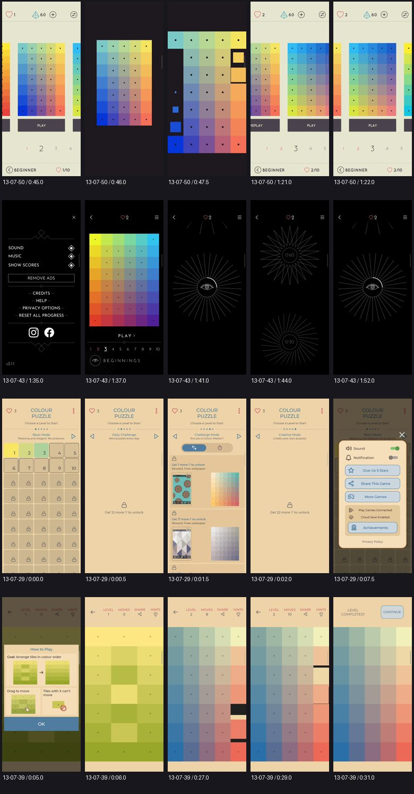

# Референсы и таблица переноса

Исходный статус до реализации на 0.4.43. MATCH означает совпадение конкретного проверенного сценария. PARTIAL — реализована часть пути. MISSING — в проверенном маршруте отсутствует заявленное поведение. UNKNOWN — для вывода нужна отдельная проверка. Для авторских решений явно указано происхождение. Новые идентификаторы относятся к интерфейсу и не меняют исторический счётчик 89 строк аудита APK. [Реестр APK](https://github.com/DanilaH/mini-games-kit/blob/cf7cffc48b4925a897c6613949c771d3325713bb/research/games/hue/porting/SOURCE_FEATURES.json) · [предыдущая сверка игровых меню](../../evidence/pr13-menu-trace.md)

Имена файлов владельца имеют вид `video_2026-11-23_13-07-SS.mp4`. В подписях указан суффикс и время внутри записи. Версии исследованного корпуса: I Love Hue 1.3.1 (176), I Love Hue Too 2.1.1 (1013), Color Puzzle 6.13.0 (142). В меню записи 43 видно v2.1.1. Для остальных роликов версия установленного приложения независимо по кадрам не установлена. По записи можно установить порядок событий и внешний вид. Положение пальца, импульс вибромотора, точная кривая easing и причина переключения между кадрами требуют отдельного подтверждения.

| sourceFeatureId | Референс и наблюдение | 0.4.43 и приёмка |
| --- | --- | --- |
| h1-picker-continuity | I Love Hue, 50, 01:21–01:23. Видны края соседей, смена работы и номера при постоянной шапке. | PARTIAL. Есть лента, края и выбор, при отпускании сбрасывается сдвиг. Проверить частичный, полный, отменённый и повторный жесты. [Код](https://github.com/DanilaH/hue-gradients/blob/92e581a641f7969b7f869a7db49a08bbbecf1d72/src/game/metaView.ts#L264) |
| h2-chapter-symbol | I Love Hue Too, 43, 01:41–01:49. Различимые линейные знаки открытой и закрытых глав, внутри закрытой — порог. | PARTIAL. Есть цветные фрагменты, финалы и условия. Добавить свои узнаваемые силуэты; проверить узнаваемость трёх глав и доступность финала. [Код](https://github.com/DanilaH/hue-gradients/blob/92e581a641f7969b7f869a7db49a08bbbecf1d72/src/game/metaView.ts#L112) |
| h2-settings-context | I Love Hue Too, 43, 01:35–01:39 и 01:49–01:52. Настройки закрываются обратно в выбор работы или главу. I Love Hue, 50, 01:37–01:38, виден уход панели. | MISSING для пары точек входа и возврата. Текущие пользовательские настройки открываются из паузы. Проверить работу, главу и паузу отдельно. [Код](https://github.com/DanilaH/hue-gradients/blob/92e581a641f7969b7f869a7db49a08bbbecf1d72/src/game/mountGame.ts#L665) |
| cp-mode-selection | Color Puzzle, 29, 00:00–00:06. На одном месте сменяются основной режим, ежедневный, испытание и редактор; видно содержание выбранного режима. | PARTIAL. Входы распределены между навигацией кампании, альбомом и другими разделами. Проверить общую точку входа и восстановление выбранного режима. [Код](https://github.com/DanilaH/hue-gradients/blob/92e581a641f7969b7f869a7db49a08bbbecf1d72/src/game/metaView.ts#L332) |
| cp-locked-reward-preview | Color Puzzle, 29, 00:01–00:05. До открытия испытания видны обои и оставшееся условие. | PARTIAL по принципу показа награды. Перенос на книгу 3/4 — наше решение. Проверить совпадение превью с реальной особой работой. Уже проверенный переход 006 сохранить. [Эпизод книги](../../evidence/pr13-book-006.json) |
| h1-picker-to-board | I Love Hue, 50, 00:45–00:48, выбор, тот же градиент в игровом масштабе, перестройка столбцов. Скорости и траектории для «Полусна» подбираются отдельно. | PARTIAL. Превью доступной работы уже использует стартовую перестановку. Нужны отдельные сценарии новой, начатой и секретной работы. [Код](https://github.com/DanilaH/hue-gradients/blob/92e581a641f7969b7f869a7db49a08bbbecf1d72/src/game/metaView.ts#L96) |
| h1-swap / h1-pins | I Love Hue, 50, около 00:50–01:09. Подвижные плитки и метки опор на поле; точное поведение при промахе из этих кадров не установлено. | PARTIAL для постановки жеста. Обмен, опоры, пустая ячейка и посадка уже реализованы. Регрессия — сравнить состояния поля и счётчика после drag, двух тапов и отмены. [Поле](https://github.com/DanilaH/hue-gradients/blob/92e581a641f7969b7f869a7db49a08bbbecf1d72/src/game/PuzzleScene.ts#L193) |
| poluson-drop-return | Предложение «Полусна» по разбору ветвлений — сохранить предмет видимым до возврата или подтверждённой посадки. | MISSING для плавного возврата при отпускании на опоре или за полем. Наличие заметного кадра скачка при успешном обмене на устройстве — UNKNOWN. Снять normal, delayed commit и отказ раздельно. [Жест](https://github.com/DanilaH/hue-gradients/blob/92e581a641f7969b7f869a7db49a08bbbecf1d72/src/game/PuzzleScene.ts#L203) · [сохранение](https://github.com/DanilaH/hue-gradients/blob/92e581a641f7969b7f869a7db49a08bbbecf1d72/src/game/mountGame.ts#L915) |
| poluson-contact-sound | Собственный стеклянный звук и штатная вибрация. Синхронизация с контактом — наша постановка. | PARTIAL. Эффекты вызываются при подтверждении, анимация обычного обмена длится 150 мс. Отметить видимый контакт и начало звука в одной записи. Вибрацию проверить вручную. [Посадка](https://github.com/DanilaH/hue-gradients/blob/92e581a641f7969b7f869a7db49a08bbbecf1d72/src/game/PuzzleScene.ts#L65) · [звук](https://github.com/DanilaH/hue-gradients/blob/92e581a641f7969b7f869a7db49a08bbbecf1d72/src/game/feedback.ts) |
| poluson-palette-atmosphere | Полноэкранный dreamy PSX, реакция на палитру и направление движения — решения владельца. | PARTIAL. У сцены уже есть фон от модели, взаимодействие и реакция на принятый ход. Проверить непрерывность в ленте, стабильность оттенков, отключённые анимации. [Интеграция](https://github.com/DanilaH/hue-gradients/blob/92e581a641f7969b7f869a7db49a08bbbecf1d72/src/game/mountGame.ts#L836) |
| poluson-book-goal-return / poluson-personal-objects | Собственные уже принятые функциональные сценарии из PR №13/14. Color Puzzle, 39, 00:29–00:31 показывает чистый рисунок после завершения как дополнительный визуальный ориентир. | MATCH по ранее записанным браузерным сценариям перехода к книге и попадания в фигуру. Прогнать заново после смены меню. Приёмка художественного качества и физического устройства ведётся отдельно. [Результаты](../../evidence/pr13-menu-trace.md) |

## Сверка 0.4.44

Статусы относятся к проверенным маршрутам браузера. [Записи, условия и остаток по телефону](../../evidence/pr16-menu-board-0.4.44.md).

| sourceFeatureId | Статус | Проверка |
| --- | --- | --- |
| h1-picker-continuity | MATCH | 005 → короткий свайп → 005 → полный свайп → 006. Проверены отмена и клавиатура. |
| h2-chapter-symbol | MATCH | Четыре авторских силуэта, цвет выполненных работ, условие главы 2, отдельный финал. |
| h2-settings-context | MATCH | Настройки возвращают исходный выбор и фокус. Проверены крест и Escape. |
| cp-mode-selection | MATCH | Подписанные входы из «Режимов», возврат к выбранному режиму и 006. |
| cp-locked-reward-preview | PARTIAL | В книге видны заработанные фрагменты и цель 006. Художественную оценку оставил владельцу. |
| h1-picker-to-board | MATCH | 006 открылась из собранного рисунка и отдельно из сохранённого поля с одним ходом. |
| h1-swap / h1-pins | MATCH | Опоры, успешный обмен, два касания, промах и отмена. Пальцы на телефоне остаются отдельным прогоном. |
| poluson-drop-return | MATCH | Непрерывное движение при промахе и подтверждённом обмене, 250 мс и отказ проверены отдельно. |
| poluson-contact-sound | PARTIAL | Три звука посадки 006 и один акцент 001 в браузере. Вибромотор и звук Android ждут устройства. |
| poluson-palette-atmosphere | PARTIAL | Переход палитры в ленте и неизменные цвета лиц плиток. Оценка света и фактуры на телефоне открыта. |
| poluson-book-goal-return / poluson-personal-objects | MATCH | Книга 3/4 → 006 → 4/4, повтор не дублирует награду. Пустой фон в личных заданиях сохраняет выбор. |

В 0.4.45 перепроверены `h1-picker-continuity` и `h2-chapter-symbol` после увеличения ленты и глав. Тап по номеру, движения в обе стороны, условие закрытой главы и возврат прошли в Chromium. Физическая проверка читаемости остаётся открытой. [Замеры по аудиту №17](../../evidence/pr17-level-scale-0.4.45.md).
