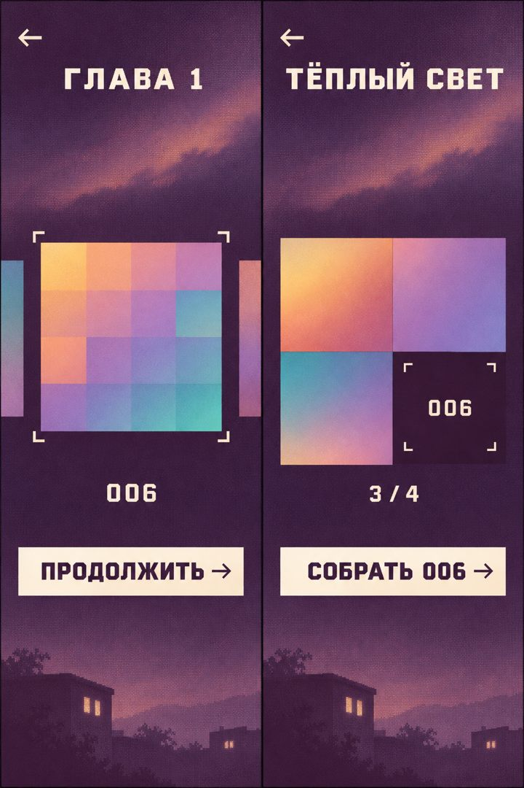
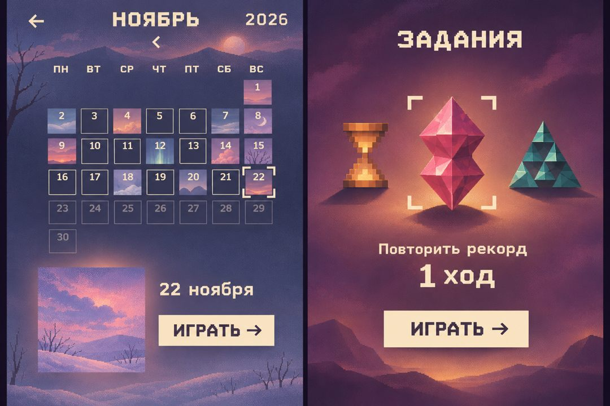

# «Полусон» · игровые меню и переходы

**Рабочее задание разработчику, 22 ноября 2026.** Начни с одного эпизода: в книге «Тёплый свет» игрок видит три цветных фрагмента, касается пустого гнезда 006, собирает поле и возвращает его цвет в обложку. Вторая книга, календарь и альбом должны выглядеть по-разному даже со скрытыми заголовками. Их отличают действия игрока: вставить фрагмент, выбрать день, развернуть работу.

**База сверки:** `feat/m0-foundation`, [0.4.35 (39)](https://github.com/DanilaH/hue-gradients/commit/b89b0ea8f97c07d38064f1c72c2cd6cc491af42d). На момент сверки открыты PR №1, 2, 5, 6, 8, 10, 11, 12. №10–11 содержат ранние итерации финала. Последнее решение по посадке — [V1.4, принят владельцем на 006](../../PROJECT_DECISIONS.md). Результаты №12 уже вошли в 0.4.35. [Исправления и границы проверки](../../evidence/pr12-audit-followup-2026-11-22.json).

## Как читать два концепта

Слева — выбор **уровня внутри главы**. Справа — конкретная книга. Берём масштаб центрального квадрата, боковые края соседей, четыре угловые скобки, тёплый непрозрачный акцент, мелкую фактуру и свет от края до края. В книге главное действие находится в самой четверти. Подпись «Собрать 006» поясняет его. Второй огромной кнопки под той же целью не требуется. В селекторе явная команда «Играть / Продолжить / Повторить» остаётся доступной.

Здесь берём сетку месяца и силуэты трёх типов заданий. В готовой игре в ячейках собранных дней видны их **настоящие градиенты**. Ноябрь, дата 22, один ход, количество предметов, пейзажи и написание букв на эскизе иллюстративны. Каждый доступный предмет имеет читаемое название ещё до выбора. Сгенерированные изображения приложены как ориентир для композиции. Текст, элементы управления, обложки работ, цвета и состояния строятся из данных игры. [Первичный концепт владельца](../../spec/reference/owner-art-reference.png).

## Общий язык экранов

- **Цвет занимает весь экран.** В меню цветовой источник — текущая обложка, задача или работа. При смене выбора фон мягко переходит к её палитре. «Тёплый свет» и «Синий час» различимы по свету уже на входе. Оставь туман и мелкое зерно на периферии. Под пальцем плитка сохраняет свой цвет, геометрию и точную область захвата. Используй существующую атмосферу, учитывающую расположение цветов. На поле фон реагирует на жест и принятую перестановку, при сборке приходит к палитре результата. Правильность хода через фон не подсказываем. [atmosphere.ts · L13](https://github.com/DanilaH/hue-gradients/blob/b89b0ea8f97c07d38064f1c72c2cd6cc491af42d/src/game/atmosphere.ts#L13).
- **У предметов есть физическое действие.** Выбранное гнездо отмечают скобки, касание слегка сажает его в оправу, отменённый жест возвращает исходное состояние. У дня выбор меняет подробности, у отпечатка касание открывает работу. Подпись заранее различает выбор и запуск. Плитки, номера, даты и короткие глаголы важнее длинных описаний.
- **Геометрия и кириллица.** Прямые углы, непрозрачные поверхности кнопок, ясный контур фокуса. Пока открыта пауза, цвета вокруг неё сохраняют яркость. Большой номер и короткий заголовок допускают собственное угловатое начертание. Для мелкого текста остаётся читаемый системный шрифт. В первом пакете покажи две пробы крупного начертания на «Тёплый свет», «Синий час», «Собрано», 006, 3/4. Решение о гарнитуре остаётся у владельца, работа над взаимодействием продолжается с текущей. Времена, условия доступа и подписи к предметам остаются текстом.
- **Движение и звук.** Отмена тапа, скролл и перерисовка экрана тихие. Новое вложение фрагмента получает один короткий сухой щелчок на месте стыка. У щелчка отдельное от победного удара событие. Повторный вход в собранную книгу тихий. На подтверждённой победе оставить существующий синтезированный удар и один разрешённый виброимпульс. Музыка живёт через переходы, а настройки музыки, звуков и вибрации действуют независимо. При reduced motion или выключенных анимациях — мгновенное читаемое конечное состояние. В фоне декоративные циклы и ожидающие звуки прекращаются. [feedback.ts · L8](https://github.com/DanilaH/hue-gradients/blob/b89b0ea8f97c07d38064f1c72c2cd6cc491af42d/src/game/feedback.ts#L8).
- **Проверка на маленьком экране.** Основной просмотр 390×740, тесный 320×568, горизонтальный 568×320 и текст 150%. Объект можно уменьшить, детали прокрутить. Тап по видимой кромке и центр ведут себя одинаково. Свайп, вертикальная прокрутка, отмена касания и смена фокуса по Tab сами ничего не запускают. Стрелки и доступные кнопки дублируют листание. Цвет, форма метки и текст вместе различают закрытое, начатое и собранное. На малой ширине у календаря предусмотреть запуск выбранного дня крупной отдельной командой.

## Пакет 1. Книги → поле → та же обложка

**Сейчас.** В «Альбом → Собранное → Книги» у обеих книг есть миниатюра 2×2, список целей и запуск особой задачи после 4/4. У каждой цели есть отдельное условие. Вход в конкретную незаполненную четверть и возврат из обычного уровня к этой четверти нужно реализовать. Обычный `startLevel` очищает историю меню. Возврат из особой задачи книги и датированного события уже работает. [books.ts · L34](https://github.com/DanilaH/hue-gradients/blob/b89b0ea8f97c07d38064f1c72c2cd6cc491af42d/src/domain/books.ts#L34), [books.ts · L51](https://github.com/DanilaH/hue-gradients/blob/b89b0ea8f97c07d38064f1c72c2cd6cc491af42d/src/domain/books.ts#L51), [metaView.ts · L287](https://github.com/DanilaH/hue-gradients/blob/b89b0ea8f97c07d38064f1c72c2cd6cc491af42d/src/game/metaView.ts#L287), [mountGame.ts · L250](https://github.com/DanilaH/hue-gradients/blob/b89b0ea8f97c07d38064f1c72c2cd6cc491af42d/src/game/mountGame.ts#L250).

| Книга | Слева вверху → справа вверху → слева внизу → справа внизу |
|---|---|
| Тёплый свет | Собрать 001 · собрать 004 · собрать 003 идеально без помощи · собрать 006 |
| Синий час | Собрать 002 · собрать 008 · собрать 010 · пройти первое испытание `challenge-v1-1` |

1. Книги доступны и при 0/4. Порядок слотов постоянный. Силуэт, номер или знак испытания и короткая цель читаются на пустом месте. Каждое пустое гнездо — отдельная доступная кнопка. Постоянная подпись в нём сообщает цель до нажатия. Один завершённый тап по доступному гнезду запускает цель. Фокус клавиатуры лишь выделяет её, Enter запускает. Заполненное место показывает заслуженный цвет и условие «Выполнено». События с датой остаются достижимыми из этого же раздела.
2. Доступное пустое место запускает или продолжает **свою** цель. Для уже собранного 003 без нужного рекорда предложить повтор для идеального результата. Если есть незаконченная попытка, продолжить её. Закрытая цель показывает реальное условие открытия из правил кампании/испытаний. Запуск через книгу соблюдает эти же права. Например, доступ к 006 в первой главе появляется после 005. [progression.ts · L14](https://github.com/DanilaH/hue-gradients/blob/b89b0ea8f97c07d38064f1c72c2cd6cc491af42d/src/domain/progression.ts#L14), [challenges.ts · L82](https://github.com/DanilaH/hue-gradients/blob/b89b0ea8f97c07d38064f1c72c2cd6cc491af42d/src/domain/challenges.ts#L82).
3. Перед уходом запомнить источник, книгу и гнездо. Подход к полю может визуально приблизить выбранную четверть. Первое игровое касание относится к доске только после открытия поля и нового нажатия. В паузе есть «К книге». При выходе до решения та же четверть выбрана, попытка и прогресс сохранены. Контекст должен пережить сворачивание и восстановление активной попытки. У старого сохранения без источника действует обычный маршрут.
4. После последнего обмена проходит принятый финал V1.4. Только на готовом результате игрок выбирает «К книге». Это основная команда данного входа, переход ручной. Данные кампании и её награды фиксируются обычным путём. При возврате сравнить подтверждённое состояние цели до и после. Вернувшись в книгу, игрок сначала узнаёт ту же обложку и то же гнездо. Фрагмент с градиентом решённой работы входит в своё место, по двум внутренним кромкам коротко проходит свет. Щелчок приходится на стык. Счётчик показывает фактическое заполнение. Только при переходе с 3/4 на 4/4 появляется метка особой задачи. Это отдельное событие уже на экране книги; в победной сцене обложку не показывать. Вложение проиграть один раз на новом выполнении. Уже выполненная цель, проигрыш, отмена, повторное открытие и неподходящий результат оставляют обложку в фактическом состоянии. После перезапуска восстановить заполнение из сохранения, без повторной постановки звука или награды.
5. На 4/4 доступна **особая задача именно этой книги**. Отдельная метка с подписью на обложке запускает её. Сбор четырёх целей и прохождение самой задачи — разные достижения. При проигрыше доступны «Повторить» и «К книгам», при победе — возврат к той же книге. После победы особую задачу можно повторять. Для второго раздела сохранить его идентичность при возврате. 60/60 кампании не запускает новый цикл. Правила нового цикла ждут решения владельца.

**Контрольный дубль.** Подготовить профиль с пройденными 001–005 и идеальным чистым 003, оставить 006 незавершённым. Записать одним дублем «Альбом → Книги → Тёплый свет 3/4 → гнездо 006 → последний обмен → К книге → 4/4 → особая задача». Отдельно: закрытый 006, решение 003 с помощью, первый challenge второй книги, проигрыш особой задачи и повторный вход после перезапуска. Проверить число побед, XP, прав и засчитанных целей до/после. В отдельном обычном входе в 006 сохраняются «Дальше» при наличии следующего уровня и «В альбом». [Проверка исходного поведения книг](../../../tools/books-browser-check.mjs).

## Пакет 2. Личные задания

**Сейчас** список выводит реально выданные задачи. `past` требует предыдущий личный результат, `present` имеет свой таймер, `future` знакомит со сложным незавершённым полем. После выдачи задача привязана к дате и типу. [personal.ts · L60](https://github.com/DanilaH/hue-gradients/blob/b89b0ea8f97c07d38064f1c72c2cd6cc491af42d/src/domain/personal.ts#L60), [metaView.ts · L287](https://github.com/DanilaH/hue-gradients/blob/b89b0ea8f97c07d38064f1c72c2cd6cc491af42d/src/game/metaView.ts#L287).

| Предмет | Что игрок видит у выбранного | Что запускается |
|---|---|---|
| Двойной кристалл | «Улучшить рекорд» и предел ходов. Когда достигнут математический минимум — «Повторить рекорд» с реальной целью | Сохранённая задача `past` |
| Песочные часы | «Успеть по времени», длительность выданной задачи. У начатой — оставшееся время попытки | `present` с тем же таймером после возврата |
| Составная мозаика | «Сложное поле», название выданного уровня, его палитра | `future` без добавленного лимита ходов или времени |

Тап по предмету меняет выделение и описание. «Играть», «Продолжить» или «Повторить» выполняет одно действие. Раскладывать ровно имеющиеся предметы: два на свежем профиле в зафиксированном сценарии, три в развившемся, один при единственной доступной задаче. Порядок типов устойчив при смене выделения. История выполненных остаётся доступной. Новый локальный день обновляет набор даже в открытом меню. Команда «К заданиям» на результате возвращает к набору. Явный повтор запускает эту же задачу. Повторная победа не дублирует отметку. При редком пустом наборе показать дату, короткое состояние и возврат. [Выдача на реальных профилях браузерного теста](../../evidence/pr12-audit-followup-2026-11-22.json).

## Пакет 3. Календарь, архив и события

**Сейчас** опубликованные даты идут списком. Есть проверенный предел `through`, слоты, сохранённые попытки и множество решённых дат. Личные задания меняются по локальной дате. Общий каталог использует подтверждённую дату источника (UTC). [daily.ts · L21](https://github.com/DanilaH/hue-gradients/blob/b89b0ea8f97c07d38064f1c72c2cd6cc491af42d/src/domain/daily.ts#L21), [mountGame.ts · L303](https://github.com/DanilaH/hue-gradients/blob/b89b0ea8f97c07d38064f1c72c2cd6cc491af42d/src/game/mountGame.ts#L303).

- Семь колонок с понедельника, календарно верные смещения и длины месяцев. Стрелки листают месяцы архива; при разрыве можно перейти к ближайшему месяцу с записями. При первом входе выбрать доступную текущую дату каталога либо ближайшую доступную предыдущую. При возврате выбрать именно открытую дату и её месяц, включая архивную.
- Выбранный день получает скобки. У решённого — миниатюра из данных **этого** поля и отметка завершения. У незавершённого — знак попытки, у доступного — число. У будущего либо отсутствующего в принятом каталоге дня нет запуска. Нажатие на доступную дату только выбирает. Под сеткой видны дата, состояние и отдельное действие: старт, продолжение или повтор.
- Пустой профиль и загрузка, ошибка с «Повторить загрузку», кэш при недоступном источнике, отклонённое обновление и пустой архив имеют отдельные состояния. При ошибке кэш остаётся доступен. Никаких выдуманных дат, изображений побед или локальной замены общей задачи личной.
- Отмеченная издателем задача с `slot.feature` видна в «Книгах» с названием и датой. Один и тот же день из календаря и из события открывает тот же слот. Результат и выход из паузы возвращают к **месту входа**. Проверить с двух профилей, при возврате из прошлого месяца, при переходе через границу месяца и после сетевого отказа. Повтор даты не добавляет вторую победу за этот день. [Стендовые прогоны 0.4.35](../../evidence/pr12-audit-followup-2026-11-22.json).

Продолжение очереди и условия сдачи — [остальные экраны и приёмка](SCREENS-AND-QA.md). [Реестр соответствия и источники](TRACE.md).
