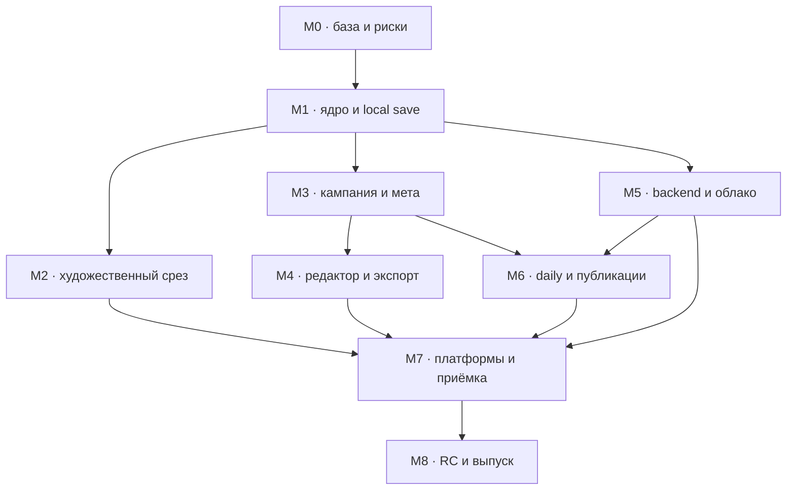

# ХУЕ / «Полусон» — роудмапа 1.0

**18 ноября 2026. План полного первого релиза по [PRODUCT_SPEC](PRODUCT_SPEC_1_0.md).** Сейчас создаются документы; приведённые ниже работы ещё не означают поручение выполнять их в этом проходе.

## Как читать план

M0…M8 — этапы с проверяемыми выходами, не календарные обещания. Дата старта, состав исполнителей и минимальные устройства ещё не закреплены, поэтому сроки в днях не выдуманы. После M0 и первого M1-среза оценить оставшийся объём по фактической скорости и поставить календарные даты. Размер этапа S/M/L — относительная сложность, не длительность работы агента.

Приоритет P0 означает сохранность/доступ/критический путь; P1 — остальной обязательный релизный объём. P1 не означает «можно убрать из первой версии». Работа с дополнительными площадками после завершения первых адаптеров не заменяет обязательные функции.

Три линии можно вести с пересечением: игра и мета; backend/identity/daily; визуальная подача и приёмка. Общие схемы и content contracts сначала фиксируются, затем используются обеими реализациями. Ответственный за этап — роль, а не назначенный без ведома владельца человек.

M4 может готовить чистый валидатор и форму после M1; связь с earned-правами завершается после M3. M5 не ждёт конца всей кампании/редактора: server contracts и fixtures готовы раньше. Массовая стилизация M3/M4/M6 ждёт принятого M2; доменная логика ждать не обязана. Граф показывает зависимости, а не разрешает выпускать промежуточный набор как полную игру.

## Обзор этапов

| Этап | Приоритет / размер | Что можно передать на проверку | Основная зависимость |
| --- | --- | --- | --- |
| M0 | P0 / M | Зафиксированный consumer, воспроизводимая сборка и реальные identity probes | Репозиторий/площадки/доступы |
| M1 | P0 / L | Настоящая игра с первыми пятью, всей моделью 15 и надёжным local save | M0 |
| M2 | P1 / M | Один принятый gameplay→win эпизод по приложенному концепту, Art Bible | M1 |
| M3 | P1 / M | Кампания 60, главы, альбом, best и earned-права | M1; итоговый вид после M2 |
| M4 | P1 / L | Полный локальный редактор/версии, авторское прохождение и экспорт | M1/M3; вид после M2 |
| M5 | P0 / L | Identity, сервер, outbox, два устройства, конфликты/reset/delete | M0 proofs + M1 схемы |
| M6 | P1 / M | Общий daily, архив, offline cache и publisher с принятым запасом | M3/M5 + редакционный процесс |
| M7 | P0 / L | Полный набор функций на Android и hosted web, реклама, fault/device QA | M2–M6 |
| M8 | P0 / M | Принятый RC, store-пакет, эксплуатация и контролируемый выпуск | M7 + внешние gates |

## M0 — рабочая база и проверка дорогих рисков

**Цель:** не строить весь продукт поверх непроверенной identity или неподходящего шаблона. Роль: разработчик клиента + backend/integration; владелец предоставляет уже нужные настройки/решения конкретным действием, а не абстрактным разрешением «на всё».

1. Установить фактический consumer repository, branch/HEAD, bundle/application IDs; не считать отдельную художественную web-пробу полноценным consumer.
2. Прочитать актуальные AGENTS/API/Task Router. Зафиксировать runtime pin и guidance pin отдельно. Yandex — tested bootstrap; Android — проверенный локальный scaffold с отдельной приёмкой native storage/lifecycle. Запустить предусмотренный guidance doctor и smoke проверки инструкций.
3. Задать структуру domain/render/local-store/platform/sync, policy/content/rules/schema версии, формат operationId и test fixtures. Ничего не выносить в общие kit API только ради одной игры.
4. Собрать минимальные debug Android и hosted draft, проверить загрузку/foreground/background на реальных целях; записать устройства, ОС/WebView/browser, SHA и конфигурацию.
5. Провести реальный Яндекс ID proof exchange Android и signed Player exchange web. Подтвердить доступность секрета для этой игры. Если её нет, записать конкретный blocker и проверенный альтернативный контракт; не доверять userId и не добавлять платную механику ради галочки.
6. Выбрать инфраструктурный путь API/DB, namespace окружений, хранение секретов, backup/privacy владельца процесса. Отдельно проверить capabilities рекламных SDK, без изменения пользовательской ad policy.
7. Назвать минимальное и среднее физические устройства, целевые viewports и наблюдаемые performance бюджеты; начать реестр рисков G01–G07.

**Выход:** DECISIONS + SESSION_HANDOFF с точными pins, reproducible build, две небольшие записи проверок платформы/identity, список конкретных внешних недостающих настроек.

**Gate:** сборка повторяется; consumer не теряет local bootstrap при недоступной сети; identity не основана на присланном UID. Неопределённая web identity блокирует обещание cloud на этой платформе, но не чистое ядро M1.

## M1 — игровое ядро и подтверждённое сохранение

**Цель:** получить настоящую управляемую головоломку, на которой можно честно оценивать оформление. Роль: клиент/домен + storage; P0.

1. Перенести immutable определения первых 15 без изменения hash/правил; typed models, validator, swap, solved, cycle minimum, assist categories. Тестировать данные отдельно от renderer.
2. Реализовать крупную прямоугольную сетку и единые rounded bounds для input/render. Tap–tap, drag, pins, deselect, keyboard, последний pointerup, один active pointer, cancel/background/resize и быстрый следующий жест.
3. Настроить SQLite/IndexedDB интерфейс commit/load/readOperation. Одна транзакция на accepted action, revision CAS для вкладок, operation ledger, завершение/права/outbox skeleton. Не начинать с localStorage, который потом придётся объявить transactional.
4. Реализовать бесплатный help с commit до раскрытия, restart confirmation, back stack, corrupted snapshot recovery, раздельные best и no-op без хода/звука.
5. Обучение первых пяти: первый обмен/pin объясняются однократно; onboarding flags сохраняются вместе с фактическим действием.
6. Реальная победа после commit; возврат к полю, повтор, продолжение. Результат не определяется окончанием анимации.
7. Fault QA: остановки до/после commit, неизвестный ответ, повтор operationId, storage full, force-stop, два writer. Проверять физические адаптеры, а не только Python-модель.

**Поставляемая сборка:** первые пять доступны обычным игровым маршрутом, 15 definitions и replay fixtures исполняются; полный ввод/help/save работает. Это внутренний vertical slice.

**Gate:** CORE-01…10, TECH-03/04 из матрицы PASS; последний подтверждённый ход/победа не теряются, повтор не удваивает результат. Разница физических гарантий web/native записана. M1 не выдаётся за полный первый релиз.

## M2 — один художественный срез и Art Bible

**Цель:** получить заявленное настроение прикреплённого изображения без потери цветовой задачи. Роль: visual/feel + клиент; P1.

1. На одной и той же собственной задаче собрать игру, выбор/drag, помощь и победу. Референс из PRODUCT_SPEC §8 служит эталоном света/фактуры; текущая web-проба — только доказательство идеи реактивности.
2. Сравнить не больше двух реальных гарнитур на одинаковых RU-экранах, включая длинные подписи и 150%. Шрифт картинки не возвращается автоматически; зафиксировать выбранный шрифт, лицензию, веса/цифры/роли.
3. Реализовать мягкую цветовую атмосферу, свечение/зерно/тёмные края; отделить от точных плиток. Один low-poly символ победы, без магазина ресурсов/новой сущности прогресса.
4. Настроить spatial palette, idle/selection/drag/swap/cancel/win по causal event table. Проверить, что histogram неизменен, а перестановка меняет фон. Не использовать score-to-solution.
5. Определить игровые visual tokens, sound/haptic event map, low-effects/reduced-motion варианты и renderer budget. Проверить no-op/mute/resume и прерывание анимации новым вводом.
6. Показать владельцу реальные кадры и короткие записи before→gesture→commit→win на телефоне. Проверить, что точные RGB не меняются эффектами; сверить фон по характеру с концептом.

**Выход:** принятый эпизод, Art Bible с параметрами и компонентами, лицензированные шрифты/звук, сохранённые evidence. Библиотека из сотни необязательных декоративных ассетов не нужна.

**Gate:** ART-01…09 и затронутые UX/NFR проходят. Художественное решение подтверждено владельцем на конкретной сборке; технические проверки не объявляются его одобрением. До этого массовая стилизация остальных экранов не фиксируется как финальная.

## M3 — кампания, коллекция и мотивация

**Цель:** завершить полный progression loop. Роль: gameplay/meta + контент + UI; P1.

1. Подключить 60 кандидатных definitions, главы 15/10 и первые пять последовательно. После №5 — свободный выбор остатка; рекомендовать следующий непройденный без запрета другого.
2. Реализовать unique completion, earned rights, clean/assisted best, perfect marks, устойчивую выдачу нескольких наград и сохранение старых прав при новой policyVersion.
3. Главная/кампания/глава/альбом/карточка: пустые, начатые, закрытые, 10/15, 15/15, последняя глава, повтор без награды, sync arrivals. Недоступная миниатюра не раскрывает готовую задачу.
4. Встроить права на шесть макетов, базовый clean с первой победы, создание копии из альбома и системную страницу главы. Экспортный renderer завершается M4.
5. Начать человеческую приёмку всех 60: маршрут, опоры, близкие оттенки, паузы, повторяемость. Решения по четырём предупреждениям хранить по level/fingerprint/device, не общим «нормально».

**Выход:** полная локальная кампания и альбом с настоящими earned-правами, статус каждого кандидата. Таблица 9→10/14→15/повтор/assist/изменение порога воспроизведена.

**Gate:** CONTENT-01…04 и META-01…04 PASS; ни own work, ни повтор не фармят кампанию. Технически валидные, но не просмотренные уровни остаются candidates до M7.

## M4 — личный редактор и экспорт

**Цель:** полное творческое продолжение, включая ошибки и версии. Роль: клиент/инструменты + visual; P1.

1. Draft list, пустая работа и копия источника; режимы размера/палитры/опор/старта. Настроить preview/Apply/Cancel, нормализацию одной оси и стабильный rename.
2. Перенести чистый validator и canonical fingerprint. Раздельные hard errors/close-colours warning, playable snapshot, авторское прохождение по точной revision.
3. Atomic draft writes, revision history, debounce без ложного saved, interrupted edit recovery, выбор recoverable branches в UI. Cloud подключается к тем же контрактам M5.
4. Собрать clean + шесть форматов + страницу главы по точным областям. Реальный font measure, overflow без потери текста, разные работы в compose, точный sRGB без декоративного tint.
5. Пройти Android и web download/share: успех, cancel, отказ ОС, нехватка работ/места. Share не вызывается автоматически, публикация не приписывается открытию системного окна.

**Выход:** личная работа от пустого draft до сохранённой авторской версии, карточки и изображения; история и ошибки доступны.

**Gate:** EDITOR-01…08, EXPORT-01…03 PASS; все 33 editor fixture сохранены в parity suite. Offline работает, invalid draft не становится playable, rename не снимает проверенность, собственные работы не фармят official rewards.

## M5 — production cloud и профили

**Цель:** два устройства действительно продолжают данные без потерь. Роль: backend + native/web identity + клиент; P0.

1. После M0 proof реализовать две namespace identity, verified session/refresh/revoke, ресурсную авторизацию, отсутствие токенов/содержимого работ в логах.
2. Реальная PostgreSQL schema: profile lock/epoch, unique operations/completions/rights, best, attempts/work graph, cursors/high-watermarks. OpenAPI/runtime schemas и contract tests — поставляемый результат этого этапа, не псевдокод из отчёта.
3. Клиентский durable outbox, один push worker на профиль, безопасные retry тех же ID, unknown response reconciliation, limits/quota/error UI и корректное «локально/облако».
4. Изоляция guest/account A/account B, chunked transfer receipt и consumed marker. Offline logout не теряет очередь и не говорит о серверном revoke без подтверждения.
5. Конфликтные продолжения/работы, resolution node и recoverable copies; monotonic assisted, no last-write-wins по часам.
6. Online reset с epoch/идемпотентным receipt; delete profile, отзыв токенов, stale device, migrations и restore rehearsal. Privacy/backup retention документированы для реальной эксплуатации.
7. Исполнить не только прежние модельные сценарии, но и настоящие HTTP/DB concurrency, двух устройств, process kill, auth expiry/reuse, IDOR и rollback.

**Выход:** staging API, migrations, OpenAPI/schema fixtures, рабочие два клиента, администрирование без вывода секретов, backup/restore runbook.

**Gate:** CLOUD-01…08 и TECH-01…04 PASS на настоящем backend. Никакого объявления sync complete из SDK fulfilled write, без проверки domain objects/receipts. Cross-platform linking не маскируется одинаковым account name.

## M6 — daily как поддерживаемый сервис

**Цель:** новая общая задача и архив работают независимо от входа и часов устройства. Роль: backend/content ops + UI; P1.

1. Реализовать публичный month catalog, immutable blobs, проверку identity/hash/schema и атомарную установку кеша.
2. UI today/archive: fetch/published/downloaded/completed/offline/not-published/withdrawn, локальное время обновления, старый slot после UTC-полуночи.
3. Daily completion/earned учитываются один раз по slot, включая архив; revision replacement не удваивает права. Корректные best и старые snapshots сохраняются.
4. Publisher CLI/простая административная процедура: accepted content → upload → verify → atomic catalog switch → наблюдение. Создание отдельной публичной CMS не требуется.
5. Принять 30 стартовых задач, назначить календарь относительно реального старта сервиса; назначить ответственного за пачки по семь и запас ≥14. На дату спецификации календарь остаётся UNASSIGNED.
6. Проверить путешествие по зонам, ручные часы, DST, offline/no cache, потерю сети, hash mismatch, отзыв, исчерпание банка и восстановление.

**Выход:** рабочий общий daily/архив и воспроизводимый выпуск следующей пачки. Нет бессрочного обещания ежедневного контента без процесса его подготовки.

**Gate:** DAILY-01…05 и CONTENT-05 PASS. Публикация snapshot не выдумывается из локальной даты; архив не требует непрерывной серии; отсутствие каталога не блокирует кампанию/редактор.

## M7 — интеграция, реклама и полная приёмка

**Цель:** превратить набор функций в один устойчивый продукт на обеих платформах. Роль: integration/QA + visual/content; P0.

1. Подключить native banner/interstitial и web sticky/fullscreen отдельными адаптерами. Проверить реальную reservation/safe area, один владелец inset, generations, поздние callbacks и отсутствие бессмысленного пересоздания banner между совместимыми сценами.
2. Защита первых пяти, milestones, 180 s/3 unique, request cooldown, no-fill/SDK unready, double tap, background during ad, неизвестный show и фактический dismissal.
3. Пройти весь screen-state inventory, 150% текст, narrow/landscape/desktop, keyboard/focus, реальные touch края и OS share. Посмотреть игру при включённых и выключенных эффектах.
4. Записать performance на минимальном и среднем устройстве: cold/warm playable, p95 frame/input, 15 min session, большой альбом/история, реклама/resume. Оптимизировать подтверждённый bottleneck; не выбрасывать художественный характер вслепую.
5. Полный two-device/offline/update matrix, migration from previous test schema, storage exhaustion, retry/unknown response. Ни одной потерянной подтверждённой записи/права в обязательных сценариях.
6. Закрыть человеческую приёмку 60+30, обучения/темпа, четыре цветовых предупреждения и художественный gate. Решения записываются с build/fingerprint, а не с обещанием проверить позже.

**Выход:** release candidate на Android и hosted web, evidence-index, заполненная матрица, перечень известных некритических ограничений, без фиктивных PASS.

**Gate:** все обязательные строки матрицы PASS; нет open P0 data/access/game-blocking дефектов. Если блок не проходит, RC не объявляется полным релизом; исправляется причина или явно пересматривается контракт с владельцем.

## M8 — эксплуатационная готовность и выпуск

**Цель:** выпустить принятую игру, а не только собрать пакет. Роль: владелец выпуска + разработчик/ops.

1. Закрепить финальные versionCode/build/content/rules/schema/policy версии, reproducible signed build, release artifact hashes; проверить отсутствие mock/debug escapes и секретов.
2. Финальный walkthrough по правилам выбранных площадок на дату подачи: lifecycle/loading/gameplay signals, ads, auth, данные, export/share и доступные ссылки. Дополнительные площадки добавляются после официальной проверки доступности и стоимости адаптера.
3. Реальные title/description/icon/screenshots из принятой сборки. Рабочее название и локализации утверждены; концепт не выдаётся за скриншот store.
4. Утвердить privacy/delete/backup retention, протестировать restore, alerts/error triage и процедуру снятия ошибочного daily. Секреты и кабинеты не помещать в handoff.
5. Владелец выполняет или явно поручает финальную публикацию/договорные действия. Техническая готовность не является автоматическим разрешением на любую внешнюю публикацию.
6. Наблюдать реальные save/crash/latency/ad reports и first-five funnel. D1/D7 считать по фактическим пользователям/окнам; не обещать удержание/доход по одному тесту. Изменения политики идут отдельной версией с защитой earned-права.

**Выход:** опубликованный конкретный build и эксплуатационный handoff. При внешней модерации pending фиксируется отдельно от готовности сборки.

## Пакеты задач для разработчика

Каждая задача начинается с входа: актуальный consumer HEAD, затронутые ID требований, конкретная ошибка/результат и принятие. Завершение: commit/build, тесты, запись эпизода для input/motion, известные ограничения, KIT IMPACT. При обновлении handoff переписывать его под итоговое состояние, не накапливать противоречивые планы.

Первое поручение: «Выполни M0 из ROADMAP_1_0, сохрани все OWNER-решения PRODUCT_SPEC_1_0. Не меняй художественный референс и не вырезай обязательный scope. Перед большими cloud-работами проверь реальную identity capability двух платформ. Передай pins, reproducible сборки/probes, gates и конкретный следующий пакет M1».

После принятого M1 следующее поручение ограничивается M2-срезом и/или явно выбранным доменным пакетом. Не давать агенту «сделай всё на вкус» и не требовать снова исследовать все APK: исследования уже служат входными данными.

## Что не является завершением

- Скриншот или анимация вместо принятого игрового состояния.
- Существование кнопки «Облако» без двух устройств и verified identity.
- 30 JSON вместо календаря/publisher/оператора.
- Случайный pass бота вместо человеческой приёмки цветов и темпа.
- Web mock callback вместо native/Web SDK lifecycle.
- Формально перечисленная мета без earned-права, повторов и восстановления.
- Новые сезоны/валюты для заполнения времени вместо закрытия обязательных ошибок.

**KIT IMPACT: NONE в этом документальном проходе.** В consumer использовать подходящие существующие APIs на проверенном pin; общий модуль извлекать только при доказанной повторной потребности.
